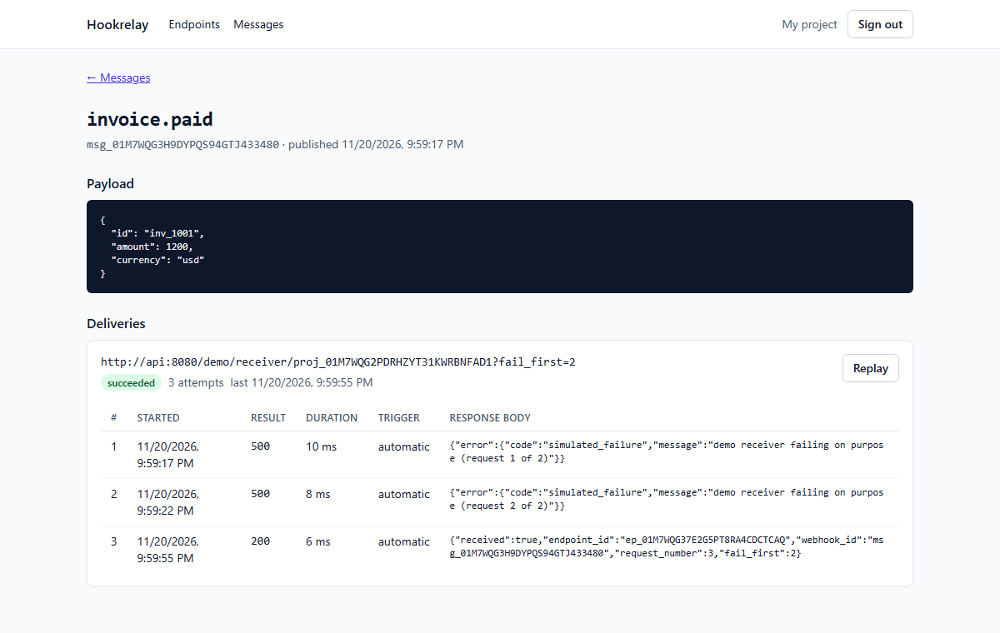
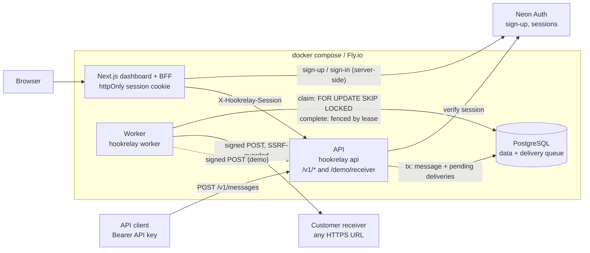

# Hookrelay

[](https://github.com/hibbanfh/hookrelay-webhook-platform/actions/workflows/ci.yml)


**A webhook delivery platform: publish an event with one API call, and Hookrelay signs it, delivers it, retries it with backoff, and keeps a searchable log of every attempt.**

**Live demo: coming soon (see [docs/deploy.md](docs/deploy.md)).** Planned URLs: dashboard `https://hookrelay-web.fly.dev`, API `https://hookrelay.fly.dev`. Not deployed yet. Until then, run it locally in one command (below).



*A message sent to the built-in demo receiver, which is set to fail its first two requests. Attempts 1 and 2 return 500, and the retry with backoff succeeds on attempt 3.*

More: [endpoints page](docs/screenshots/endpoints.png), [messages list](docs/screenshots/messages.png).

## What it does

- **Publish** a JSON event with `POST /v1/messages`. It returns `202` once the message and one pending delivery per enabled endpoint are committed in a single Postgres transaction. No outbound call happens in the request. `Idempotency-Key` is supported.
- **Deliver** asynchronously from a separate worker. Requests are signed with [Standard Webhooks](docs/adr/0007-webhook-signature-standard-webhooks.md) (HMAC-SHA256), and the stored payload bytes are sent unchanged.
- **Retry** failed deliveries with jittered exponential backoff. Defaults: `5s,30s,2m,15m,1h`, which is 6 attempts over about 1h18m. Retry state lives in the database row, so it survives worker restarts.
- **Inspect** every message, delivery and attempt (status, duration, first 4 KB of the response) through the API and a dashboard.
- **Replay** any finished delivery manually, from the API or the dashboard.
- **Try it safely** with a built-in demo receiver that verifies signatures and can fail the first N requests on purpose (`?fail_first=N`).

Sign-up and sign-in use Neon Auth. API clients use bearer API keys.

## Architecture



One Go binary runs as two processes: the **API** writes the message and its deliveries in one transaction and answers `202`, and the **worker** claims due deliveries from Postgres, sends them, and records each attempt. Postgres is the only stateful dependency: it is both the system of record and the queue. The Next.js app is a same-origin backend-for-frontend (BFF). It keeps the Neon Auth session in an encrypted httpOnly cookie and forwards it to the API, which verifies it with Neon Auth and fails closed if Neon is unreachable. The demo receiver is a route on the API, and it is the only destination allowed through the production SSRF allowlist. Full design: [docs/architecture.md](docs/architecture.md).

## Engineering highlights and trade-offs

| Problem | Approach | Trade-off | ADR |
|---|---|---|---|
| Queue without a broker | Deliveries are rows in Postgres. Workers claim them with `FOR UPDATE SKIP LOCKED` under a lease, and completion is fenced by a lease token, so a worker that lost its lease writes nothing. | Polling (default 500 ms) instead of push, and throughput is bounded by Postgres. Fine for this scale, and one fewer system to run. | [0001](docs/adr/0001-postgres-as-delivery-queue.md), [0014](docs/adr/0014-delivery-worker-polling-lease-and-fenced-completion.md) |
| Atomic publish plus idempotency | Message, idempotency key and deliveries commit in one transaction. The key is reserved first with `INSERT ... ON CONFLICT`, so concurrent identical requests create one message. | Idempotency keys expire after 24 h. | [0013](docs/adr/0013-publish-transaction-idempotency-and-outbox-ownership.md) |
| SSRF | Destinations are checked at registration and again at dial time (every resolved address is checked, and the checked address is the one dialed). Production can lock destinations to the demo receiver only. | The public demo cannot call arbitrary URLs. | [0003](docs/adr/0003-ssrf-protection.md), [0017](docs/adr/0017-demo-receiver-postgres-hit-counter-and-derived-allowlist.md) |
| Byte-exact payloads | Payloads are stored as `bytea`, not `jsonb`, and spliced into API responses without re-encoding, so the signed bytes round-trip exactly. | Payloads cannot be queried with JSON operators. | [0015](docs/adr/0015-inspection-read-path-summaries-cursors-and-cross-module-reads.md) |
| Replay races | Replay is one conditional `UPDATE ... WHERE status IN ('succeeded','failed')`. Ten concurrent replays give exactly one `202`, and the rest get `409`. | Replay reuses the delivery row, so earlier attempts stay but the status is overwritten. | [0016](docs/adr/0016-replay-as-conditional-requeue-with-the-row-trigger.md) |
| Demo receiver counter | Hit counts live in Postgres, using two autocommit statements (upsert, then a bounded `SKIP LOCKED` sweep) so no statement waits while holding a lock. | Costs one write per verified demo request. | [0017](docs/adr/0017-demo-receiver-postgres-hit-counter-and-derived-allowlist.md) |
| Maintainable backend | Clean Architecture per module, Google Wire composition root, dependency rules enforced by `depguard` and `scripts/check-layers.sh`. | More packages and indirection than a small service needs. | [0005](docs/adr/0005-clean-architecture-and-manual-di.md), [0010](docs/adr/0010-per-concern-sub-packages-per-module.md), [0012](docs/adr/0012-google-wire-and-per-dependency-libraries.md) |
| Dashboard auth | Neon Auth for accounts, BFF holds the session in an httpOnly cookie, Go verifies sessions (5 s positive cache). | Depends on a third-party auth service. | [0011](docs/adr/0011-dashboard-auth-neon-auth-sessions.md) |

All ADRs are in [docs/adr/](docs/adr/). A longer write-up is in [docs/case-study.md](docs/case-study.md).

## Quickstart

Prerequisites: Docker with Compose, and `make`.

```sh
make dev
```

This builds and starts Postgres, runs migrations, seeds a demo project, then starts the API (`http://localhost:8080`), the worker and the dashboard (`http://localhost:3000`).

Dashboard sign-up needs Neon Auth: set `NEON_AUTH_BASE_URL` (see `.env.example`). Without it the stack still runs, every dashboard session is rejected, and API keys keep working, as below.

**Publish a message** with the seeded demo project. The key is a local-only development default from `docker-compose.yml`:

```sh
export HOOKRELAY_API_KEY=hr_demo_key_local_only_not_a_real_secret_00000

curl -X POST http://localhost:8080/v1/messages \
  -H "Authorization: Bearer $HOOKRELAY_API_KEY" \
  -H "Content-Type: application/json" \
  -H "Idempotency-Key: order-1001-paid" \
  -d '{"event_type":"invoice.paid","payload":{"id":"inv_1001","amount":1200}}'
```

Expect `202` with the message ID. Then list what happened:

```sh
curl http://localhost:8080/v1/messages -H "Authorization: Bearer $HOOKRELAY_API_KEY"
```

**Demo receiver.** `hookrelay seed` creates two endpoints for the demo project that point at the built-in receiver: one healthy, and one flaky (`?fail_first=2`) that returns `500 simulated_failure` for the first two verified requests. Publish a message as above and the flaky endpoint shows attempts 500, 500, 200 with the default retry schedule (5 s, then 30 s). In the dashboard, "Use demo receiver" fills the exact receiver URL for your own project, and you can append `?fail_first=N` (0 to 10).

Other commands: `make down` (stop), `make migrate-up`, `make migrate-down`, `make seed`, `make gen-api`.

**API docs:** the contract is [api/openapi.yaml](api/openapi.yaml) (OpenAPI). The dashboard's TypeScript types are generated from it. There is no hosted Swagger UI yet.

## Tests and quality gates

```sh
make test   # backend (go test -race -tags integration ./...) + frontend (npm test)
make lint   # gofmt, go vet, golangci-lint, layer rules, eslint, tsc
make e2e    # Playwright against the running compose stack
```

- **Backend:** table-driven unit tests, plus integration tests against real Postgres with Testcontainers (needs Docker). The integration tests cover the concurrency cases: ten concurrent replays, concurrent identical publishes, concurrent demo-receiver counters, and a kill-and-recover worker. Signatures are checked against the reference Standard Webhooks library and its test vector.
- **Frontend:** unit tests and Playwright E2E specs (`frontend/e2e/`). The sign-up flow runs against the real Neon Auth when `E2E_NEON=1`.
- **CI** ([ci.yml](.github/workflows/ci.yml)) runs on every push and pull request: Wire graph is current, gofmt, `go vet`, golangci-lint, layer rules, `govulncheck`, tests with `-race`, a migrations up/down/up check, frontend lint/typecheck/test/build, generated API types are current, and Playwright E2E against docker compose.
- **Deploys** are gated: the deploy jobs run only when the `FLY_API_TOKEN` secret exists and CI has passed.
- Not measured yet: load-test numbers and a published coverage figure. Coverage is uploaded as a CI artifact only.

QA evidence and bugs found and fixed: [docs/test-plan.md](docs/test-plan.md), [docs/backlog.md](docs/backlog.md).

## Tech stack

Go 1.26 (`net/http`, `pgx`, `slog`, Google Wire, `golang-migrate`), PostgreSQL 16, Next.js (App Router) with TypeScript, Tailwind CSS and TanStack Query, Neon Auth, Docker Compose, GitHub Actions, Fly.io (config in `backend/fly.toml` and `frontend/fly.toml`).

## Project structure

```
api/openapi.yaml        API contract (source of truth for backend and frontend types)
backend/
  cmd/server/           entrypoint: api | worker | migrate | seed
  wire/                 composition root (Google Wire)
  internal/
    project/ endpoint/ message/ dispatch/ demoreceiver/   one module each, Clean Architecture
    library/            one package per dependency (postgres, netguard, secretbox, ...)
    platform/           config, HTTP middleware, health
  migrations/           SQL migrations (embedded in the binary)
frontend/               Next.js dashboard, BFF routes, Playwright specs
docs/                   PRD, architecture, ADRs, backlog, test plan, deploy guide, case study
```

## Roadmap

P0 (v0.1.0) is complete: US-001 to US-008, US-010 and US-025. Next, from [docs/backlog.md](docs/backlog.md):

- US-009: filter endpoints by event type
- US-011: rotate an endpoint's signing secret
- US-012: rate-limit the publish API per key (none today, including the public demo receiver)
- US-013: multiple API keys and revocation
- US-014: bulk replay of failed deliveries
- US-015: delete an endpoint
- US-016: data retention cleanup job
- US-017: delivery metrics and tracing (no `/metrics` or tracing today)

## Docs

| Doc | What is in it |
|---|---|
| [docs/PRD.md](docs/PRD.md) | Problem, personas, scope |
| [docs/architecture.md](docs/architecture.md) | System design, data model, key flows |
| [docs/adr/](docs/adr/) | 17 architecture decision records |
| [docs/backlog.md](docs/backlog.md) | User stories, acceptance criteria, QA bugs |
| [docs/test-plan.md](docs/test-plan.md) | QA results per story |
| [docs/deploy.md](docs/deploy.md) | First deploy to Fly.io |
| [docs/case-study.md](docs/case-study.md) | One-page write-up |
| [CHANGELOG.md](CHANGELOG.md) | Release notes |
