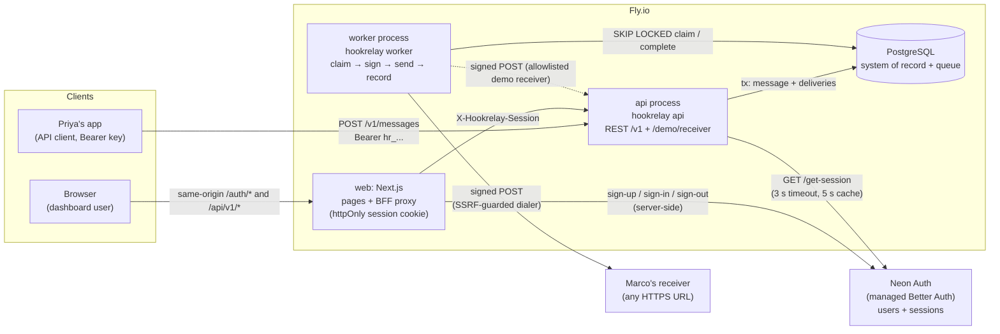
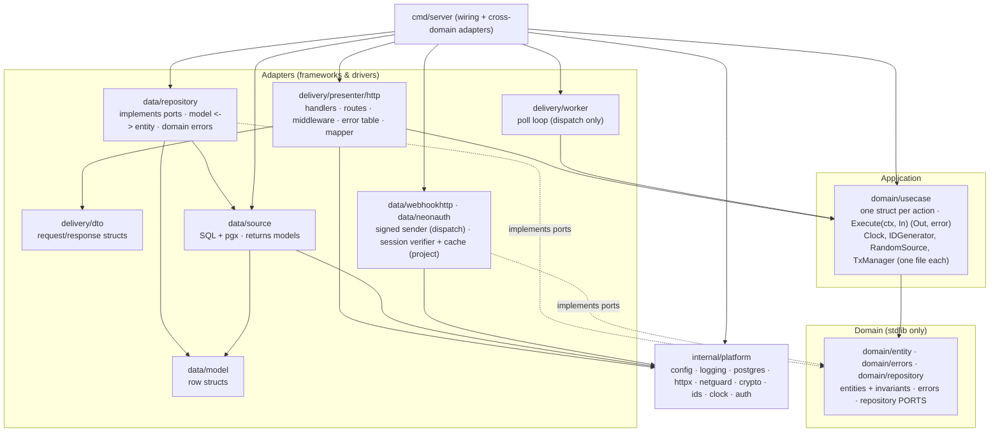
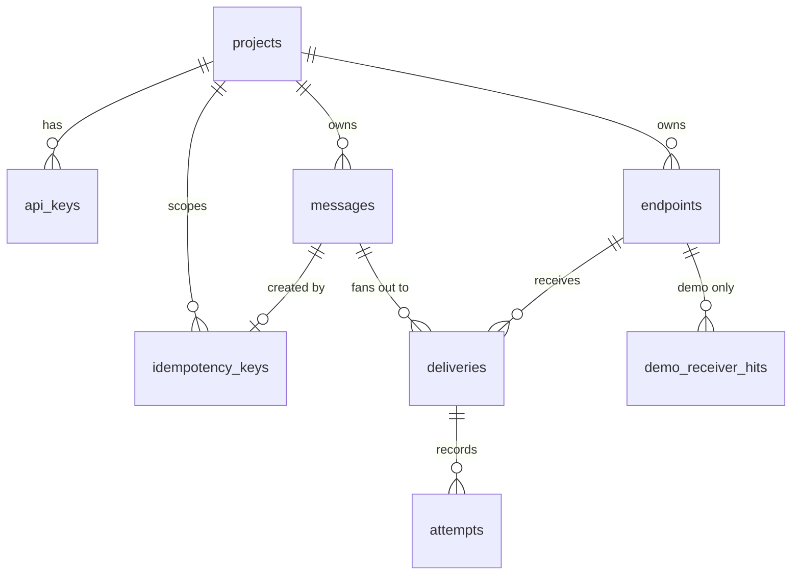
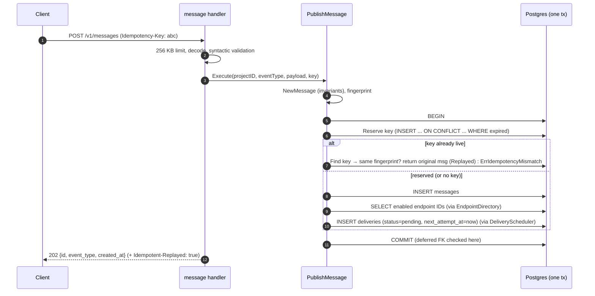
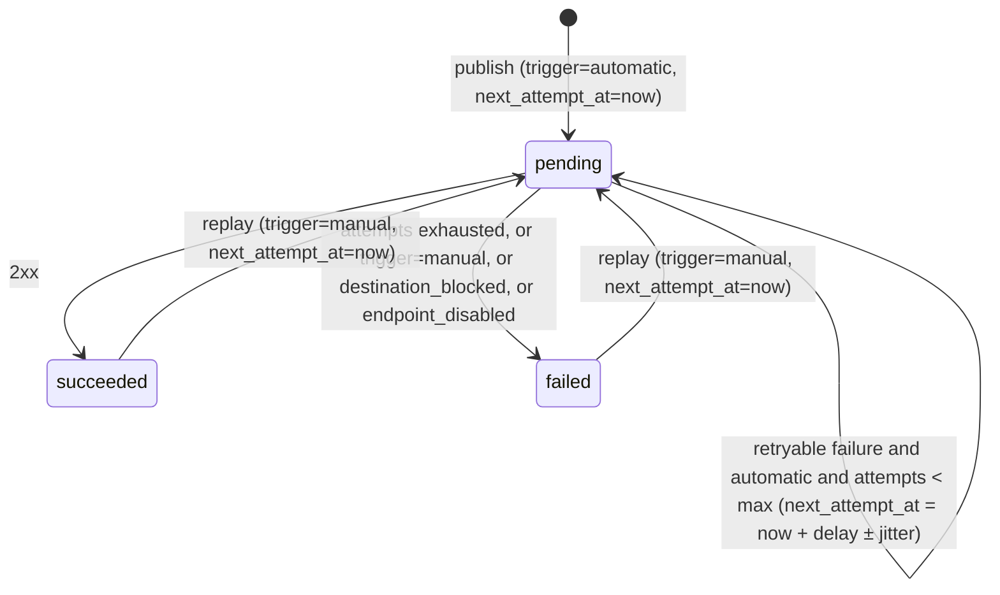

# Hookrelay: Architecture

**Status:** v0.1 design, covering MVP scope (US-001 to US-008, US-010, US-025)
**Owner:** Architect · **Last updated:** 2026-11-09
**Contract:** [`api/openapi.yaml`](../api/openapi.yaml) · **Decisions:** [`docs/adr/`](adr/)

> **In one paragraph:** Hookrelay is a Go modular monolith with two processes from one binary: an
> **API** that writes a message and its pending deliveries in one Postgres transaction and answers
> `202`, and a **worker** that claims due deliveries with `FOR UPDATE SKIP LOCKED` under a lease,
> sends Standard-Webhooks-signed requests through an SSRF-guarded HTTP client, records every
> attempt, and reschedules failures with jittered exponential backoff. Postgres is the only
> stateful dependency. It is the system of record *and* the queue. Dashboard users sign up with
> Neon Auth. A same-origin Next.js BFF keeps their session in an encrypted httpOnly cookie and
> forwards it to the API, which verifies it with Neon Auth and fails closed (ADR 0011). Each
> user owns exactly one project. Programmatic clients keep using bearer API keys.

---

## 1. Context and quality goals

| Goal (from PRD) | How the design meets it |
|---|---|
| **At-least-once, never lose a `202`** | Message and deliveries are committed atomically before `202` (§8.1). Worker leases expire, so a crashed worker's job is reclaimed (§8.2). |
| **Publish p95 < 50 ms** | Publish is one transaction of 4-5 indexed statements. No outbound I/O in the API process (ADR 0002). |
| **Delivery p95 < 2 s** | Worker polls every 500 ms and re-polls immediately when a batch was full. The HTTP call runs outside any DB transaction. |
| **Secure by default** | Hashed API keys and encrypted signing secrets (ADR 0004), HMAC signatures (ADR 0007), SSRF guard at registration *and* dial time (ADR 0003), project isolation enforced in SQL and with composite foreign keys (§7.3). |
| **Observable** | Every attempt is persisted with status, latency, body snippet and error class. Structured logs carry request, delivery and attempt IDs (§12). |
| **Explainable** | Clean Architecture per domain, one use case per endpoint, eleven ADRs, and every trade-off written down. |

Non-goals that shape the design: no exactly-once, no FIFO per endpoint, no teams or multiple
projects per user (one Neon Auth user owns one project, US-025), no payload transformations (PRD §5).

## 2. System context



The dotted line is the built-in **demo receiver** (US-010). It lives in the API process at
`/demo/receiver/{project_id}`, and it is the only destination on the SSRF allowlist.

## 3. Processes and deployment

| Process | Command | Responsibility | Scales by |
|---|---|---|---|
| `api` | `hookrelay api` | REST API, auth, validation, publish transaction, read models, demo receiver | request rate |
| `worker` | `hookrelay worker` | Claim due deliveries, send signed HTTP, record attempts, schedule retries | backlog × receiver latency |
| release | `hookrelay migrate up` | Fly `release_command`, runs before new machines start | n/a |
| one-off | `hookrelay seed` | Idempotently create the demo project (key from `SEED_DEMO_API_KEY`) and demo endpoints | n/a |
| `web` | `node server.js` (Next.js standalone) | Dashboard pages, `/auth/sign-up\|sign-in\|sign-out` (calls Neon Auth server-side), `/api/v1/*` proxy | request rate |

One Go binary and one image (ADR 0002). On Fly.io, `fly.toml` defines `[processes]` for `api` and
`worker`. The worker has no `http_service`, so it is never auto-stopped. Postgres is Fly Postgres
or an external managed Postgres (open question Q3). The frontend's host is open question Q2.

Local: `docker compose` runs `postgres`, `migrate` (one-shot), `seed` (one-shot), `api`,
`worker` and `web`. `make dev` brings it all up.

## 4. Clean Architecture

### 4.1 Layers and dependency rule



**Dependency rule:** `delivery -> usecase -> domain <- data`. Imports only point inward. Inside a
module the rule is applied per sub-package (ADR 0010):

| Package | May import (besides the stdlib) |
|---|---|
| `domain/errors` | nothing |
| `domain/entity` | `domain/errors` |
| `domain/repository` | `domain/entity`, `domain/errors` |
| `domain/usecase` | `domain/entity`, `domain/errors`, `domain/repository` |
| `data/model` | nothing |
| `data/source` | `data/model`, `pgx`, `platform/*` |
| `data/repository` | `data/source`, `data/model`, `domain/entity`, `domain/errors`, `domain/repository` |
| `delivery/dto` | `domain/entity` at most (prefer nothing) |
| `delivery/presenter/http` | `delivery/dto`, `domain/usecase`, `domain/entity`, `domain/errors`, `platform/httpx`, `platform/auth` |

- `domain/*` never imports `net/http`, `pgx`, `sqlc`, `slog` or anything outside `domain/*`.
- **Nothing imports `data/*` or `delivery/presenter` except `cmd/server` wiring** (and `data/*`
  itself). In particular `delivery` never imports `data`, and `data` never imports `usecase` or
  `delivery`.
- `platform` never imports a domain.
- **A module never imports another module.** Cross-module calls go through ports declared by
  the *caller* and implemented in `cmd/server/adapters.go` by calling the provider's use case
  (ADR 0005).
- Enforced by `depguard` in `backend/.golangci.yml` and by `backend/scripts/check-layers.sh`
  (`make lint-layers`, run in CI). Both were proven by planting a violation per rule.

### 4.2 Repository layout

```
backend/
  go.mod                         # module hookrelay (placeholder for github.com/<user>/hookrelay)
  sqlc.yaml                      # one sqlc package per domain: internal/<d>/data/source (sqlcgen output, later)
  cmd/server/
    main.go                      # subcommand dispatch only: api | worker | migrate | seed
    api.go  worker.go  migrate.go  seed.go   # per-process wiring (explicit, no DI framework)
    adapters.go                  # cross-domain port adapters (the only place that sees 2 domains)
  migrations/
    embed.go                     # //go:embed *.sql, used by `hookrelay migrate`
    0001_projects.up.sql / .down.sql   ... (see §7.5)
  internal/
    platform/
      config/      # env parsing + validation (fail fast), typed Config struct
      logging/     # slog JSON handler, redaction helpers
      postgres/    # pgxpool constructor, TxManager, Executor(ctx), pg error helpers
      httpx/       # DecodeJSON (strict), WriteJSON, WriteError, Error type, cursor codec,
                   # middleware: RequestID, AccessLog, Recover, BodyLimit, Timeout; Chain; JSON 404/405
      auth/        # WithProjectID(ctx) / ProjectID(ctx): auth context only
      netguard/    # SSRF policy (ranges, URL rules), guarded DialContext, allowlist
      crypto/      # AES-256-GCM Cipher (signing secrets at rest)
      ids/         # prefixed ULID generator (monotonic)
      clock/       # system clock
      random/      # crypto/rand RandomSource, jitter source
      health/      # GET /healthz handler (DB ping, 1 s timeout)
    <module>/      # project, endpoint, message, dispatch, demoreceiver: all share this shape (ADR 0010)
      domain/
        entity/        # one file per entity / value object (+ tests)
        errors/        # package domainerrors: sentinel + typed errors, one file per concern
        repository/    # ports: one interface per file (project_repository.go, ...)
        usecase/       # one use case per file (+ tests); Clock, IDGenerator, RandomSource each in own file
      data/
        model/         # DB row structs, tags only
        source/        # <x>_persistent.go: interface + pgx impl; owns SQL and pgx error handling
        repository/    # package repositoryimpl: <x>_repository_impl.go; model <-> entity, source -> domain errors
        webhookhttp/   # dispatch only: signed HTTP sender (outbound adapter)
        neonauth/      # project only: Neon Auth SessionVerifier + CachingVerifier (outbound adapter, ADR 0011)
      delivery/
        dto/           # request/response structs, one file per use case
        presenter/http/  # package httppresenter: handlers, routes.go, middleware.go, errors.go, mapper.go
        worker/        # dispatch only: poll loop (inbound adapter)
```

Conventions (ADR 0010): each concern is its own Go package, named after its role where the
directory name would clash (`domainerrors`, `repositoryimpl`, `httppresenter`). Technical ports
(`Clock`, `IDGenerator`, `RandomSource`, `TxManager`) are small interfaces, each in its own file
in `domain/usecase/`. Repository ports live in `domain/repository/`; other outbound ports
(cross-module, sender) get their own file next to them. SQL lives only in `data/source`.
Model-to-entity mapping lives in `data/repository`, so `domain/entity` never imports `data/model`
(ADR 0010 explains why there is no `entity.FromModel`). Only `cmd/server` imports `data/*` and
`delivery/presenter`.

### 4.3 Shared HTTP concerns

- **Middleware order** (outermost first): `RequestID → AccessLog → Recover → Timeout(10 s) →
  BodyLimit(256 KB) → mux`. Protected routes are additionally wrapped with `authed`, which is
  `project/delivery/presenter/http.RequireProject` (`POST /v1/me/project` uses `RequireSession`). Why this order: `RequestID` is outermost so every log line,
  including the panic line, carries the ID. `AccessLog` wraps `Recover` so a request that panics
  still gets its access line (with the 500 that `Recover` wrote). `Recover` wraps `Timeout` and
  `BodyLimit` so a panic anywhere below becomes a JSON 500. `Recover` re-panics
  `http.ErrAbortHandler` (net/http's sanctioned abort) and does not write a 500 once the response
  has started. An inbound `X-Request-Id` is reused only if it matches `^[A-Za-z0-9._-]{1,64}$`.
  `/healthz` access lines are logged at debug level.
- **Auth middleware (ADR 0011):** `RequireProject` accepts exactly one credential.
  `Authorization: Bearer hr_...` → `AuthenticateAPIKey` (unchanged since US-001).
  `X-Hookrelay-Session` → `AuthenticateSession` (the `SessionVerifier` port checks Neon
  `GET /get-session`, positive results cached ≤ 5 s) → `GetOwnedProject`. No credential or
  both → `401`, and Neon is not called. Every `401` body is identical. Neon unreachable →
  `503 auth_unavailable` (fail closed). A verified user without a project gets
  `409 project_not_provisioned`. The middleware puts the project ID (or, for `RequireSession`,
  the user ID) into the context via `platform/auth`. Handlers read it and pass it
  **explicitly** in the use case input. Use cases never read context values.
- **Errors:** each module's `delivery/presenter/http/errors.go` holds one table that maps its domain errors
  to `httpx.Error{Status, Code, Message, Field}` (`errors.Is` for sentinels, `errors.As` for
  `ValidationError`). `httpx.Responder.Error` (the logger is injected, no global slog) then handles `*httpx.Error`, `*http.MaxBytesError`
  (`413`) and JSON decode errors (`400`), and maps everything else to `500 internal` with one JSON log line carrying `request_id`. 401s carry
  `WWW-Authenticate: Bearer`. Handlers never pick status codes for business errors inline.
- **Pagination:** `limit` is parsed in the handler (default 20, range 1-100, else `400` with
  field `limit`). The cursor is opaque base64url of `v1|<created_at RFC3339Nano>|<id>` (for
  attempts, `v1|<attempt_number>`). Keyset query:
  `WHERE project_id = $1 AND (created_at, id) < ($2, $3) ORDER BY created_at DESC, id DESC LIMIT $limit + 1`.
  The extra row decides whether `next_cursor` is set. Cursors aren't signed: tampering can only
  move the window inside the caller's own project.
- **IDs:** `prefix_` + ULID (26 chars, Crockford base32, monotonic per process) from
  `platform/ids`, stored as `text` with a `CHECK (id LIKE 'ep\_%')`. The prefix makes IDs
  self-describing in logs. ULIDs sort by time, which keeps B-tree inserts append-mostly.
- **JSON decoding:** `DisallowUnknownFields`, a single top-level value, and `null` treated as
  omitted for optional PATCH fields.

## 5. Domains, ports and use cases

**One use case per endpoint.** Internal use cases (no route) exist only to serve another
domain's port or a CLI command.

### 5.1 `project`: tenant and API key

| Kind | Package | Name | Notes |
|---|---|---|---|
| Entity | `domain/entity` | `Project{ID, Name, OwnerID, CreatedAt}` | `NewProject` trims the name and enforces 1-100 chars → `ValidationError{Field:"name"}`. `OwnerID` is the Neon user ID, `""` for API-key-only projects. `NewOwnedProject` requires an owner |
| Entity | `domain/entity` | `SessionToken`, `SessionUser{ID, ExpiresAt}` | `ParseSessionToken`: 1-2048 cookie-octet chars, else `ErrUnauthorized`. Redacts itself like `RawKey` (US-025) |
| Entity | `domain/entity` | `APIKey{ID, ProjectID, Prefix, Hash, CreatedAt, RevokedAt}`, `RawKey`, `KeyHash` | `NewAPIKey(raw)` computes the SHA-256 hash and prefix. `ParseRawKey` checks the `hr_` + 43 base64url format. `RawKey` redacts itself in every `fmt` verb |
| Errors | `domain/errors` (`domainerrors`) | `ErrNotFound`, `ErrConflict`, `ErrInvalid` (+ `ValidationError`), `ErrUnauthorized`, `ErrCreationDisabled`, `ErrMalformedKey`, `ErrAuthUnavailable` (503), `ErrProjectNotProvisioned` (409) | |
| Port | `domain/repository` | `ProjectRepository{CreateWithKey, GetByID, GetByKeyHash, GetByOwner}` | `GetByKeyHash` ignores revoked keys. `CreateWithKey` is one CTE statement (atomic). It returns `ErrConflict` when the owner already has a project |
| Port (outbound) | `domain/repository` | `SessionVerifier{Verify(ctx, SessionToken) (SessionUser, error)}` | Adapter `data/neonauth`: `Client` (Neon `GET /get-session`, 3 s, no redirects) wrapped by `CachingVerifier` (positive results only, ≤ 5 s, `singleflight`). `Disabled` when `NEON_AUTH_BASE_URL` is empty |
| Ports (usecase) | `domain/usecase` | `Clock`, `IDGenerator`, `RandomSource` (one file each) | `Deps` bundles them with the repository for the use cases that create projects |
| Use case | `domain/usecase` | `CreateProject` | `POST /v1/projects` (public). Guard: creation disabled → `ErrCreationDisabled` (403) |
| Use case | `domain/usecase` | `GetCurrentProject` | `GET /v1/project` |
| Use case | `domain/usecase` | `AuthenticateAPIKey` | internal, used by the `RequireProject` middleware |
| Use case | `domain/usecase` | `AuthenticateSession` | internal, used by `RequireProject` / `RequireSession`. Malformed → `ErrUnauthorized` without calling the verifier |
| Use case | `domain/usecase` | `GetOwnedProject` | internal, used by `RequireProject`. Not found → `ErrProjectNotProvisioned` |
| Use case | `domain/usecase` | `EnsureUserProject` | `POST /v1/me/project`. Idempotent. `Created=true` (with the raw key) only for the call that inserted the project. A lost race (`ErrConflict`) re-reads and returns `Created=false` |
| Use case | `domain/usecase` | `SeedDemoProject` | internal, `hookrelay seed`. Idempotent: if the key hash exists, return it with `Created=false` |
| Model | `data/model` | `Project`, `APIKey` | Row structs. The key hash is `[]byte` here and `entity.KeyHash` in the domain |
| Source | `data/source` | `ProjectPersistent{CreateWithKey, GetByID, GetByKeyHash}` | Owns the three SQL strings and pgx error handling. Returns models or `source.ErrNotFound` / `source.ErrUniqueViolation` |
| Repository | `data/repository` (`repositoryimpl`) | `ProjectRepositoryImpl` | Implements the port: model ↔ entity (UTC timestamps), `ErrUniqueViolation` → `ErrConflict`, `ErrNotFound` → `ErrNotFound` |
| DTO | `delivery/dto` | `CreateProjectRequest`, `ProjectResponse`, `ProjectCreatedResponse` | One file each. `ProjectCreatedResponse` is the only type that carries the plaintext key |
| Presenter | `delivery/presenter/http` (`httppresenter`) | `Handler.Create`, `Handler.GetCurrent`, `Handler.EnsureMine`, `RequireProject`, `RequireSession`, `Routes`, error table, mapper | One handler method per file. 401 responses are byte-identical for every bad-key and bad-session case |

### 5.2 `endpoint`: receivers and signing secrets

| Kind | Name | Notes |
|---|---|---|
| Entity | `Endpoint{ID, ProjectID, URL, Description, Enabled, Secret, CreatedAt, UpdatedAt}` | `NewEndpoint` validates an absolute http(s) URL ≤ 2048 chars and a description ≤ 255. `ApplyPatch(Patch, now)` re-validates |
| Value | `SigningSecret` | `NewSigningSecret(32 random bytes)`, `String()` renders `whsec_<b64>`, `LogValue()` redacts |
| Errors | `ErrNotFound`, `ErrInvalid` (+ `ValidationError`), `ErrLimitReached` (409, message names the limit) | |
| Port | `Repository{Create, Get, List, UpdateFields, CountForUpdate}` | `CountForUpdate` takes `pg_advisory_xact_lock(hashtext(project_id))` and must run in a tx. `UpdateFields` uses `COALESCE` per field so concurrent patches of different fields don't clobber each other |
| Port | `SecretReader{GetSecret, ListSecretsByURLPrefix}` | decrypts via the injected `crypto.Cipher` in the adapter |
| Port | `Directory{ListEnabledIDs, GetTargets, GetState}` | system reads for other domains |
| Port | `URLPolicy{Check(ctx, rawURL) error}` | implemented by `platform/netguard`. Returns `ValidationError{Field:"url"}` |
| Ports (usecase) | `Clock`, `IDGenerator`, `RandomSource`, `TxManager` | |
| Use case | `CreateEndpoint` | `POST /v1/endpoints`. Flow: entity → URLPolicy → tx{CountForUpdate ≥ limit → `ErrLimitReached`; Create} |
| Use case | `ListEndpoints` | `GET /v1/endpoints` |
| Use case | `GetEndpoint` | `GET /v1/endpoints/{id}` |
| Use case | `GetEndpointSecret` | `GET /v1/endpoints/{id}/secret` |
| Use case | `UpdateEndpoint` | `PATCH /v1/endpoints/{id}`. Get → ApplyPatch → URLPolicy (only if the URL changed) → UpdateFields |
| Use case | `ListEnabledEndpointIDs` | internal, used by `message.EndpointDirectory` (US-003) |
| Use case | `GetDeliveryTargets` | internal, batch `{url, secret, enabled}` by IDs for `dispatch.EndpointCatalog` (US-004) |
| Use case | `GetEndpointState` | internal, `{enabled}` scoped by project, or `ErrNotFound` (US-006/US-007) |
| Use case | `ListDemoSigningSecrets` | internal, secrets of a project's endpoints whose URL starts with the demo receiver prefix (US-010) |

### 5.3 `message`: publish, idempotency, read model

| Kind | Name | Notes |
|---|---|---|
| Entity | `Message{ID, ProjectID, EventType, Payload []byte, CreatedAt}` | `NewMessage`: event type `^[A-Za-z0-9._-]{1,100}$`. The payload must be valid JSON whose first non-whitespace byte is `{`. Bytes are kept exactly |
| Value | `IdempotencyKey` (1-255 printable ASCII), `Fingerprint` = SHA-256(`event_type` ‖ `0x00` ‖ payload bytes) | Identical request means the same event type and byte-identical payload |
| Errors | `ErrNotFound`, `ErrInvalid` (+ `ValidationError`), `ErrIdempotencyMismatch` (422) | |
| Port | `Repository{Create, Get, List, GetMany}` | |
| Port | `IdempotencyStore{Reserve, Find}` | `Reserve` is one `INSERT ... ON CONFLICT DO UPDATE ... WHERE expires_at <= $now` (§8.1) |
| Port (cross-domain) | `EndpointDirectory{EnabledEndpointIDs(ctx, projectID)}` | → `endpoint.ListEnabledEndpointIDs` |
| Port (cross-domain) | `DeliveryScheduler{Schedule(ctx, projectID, messageID, endpointIDs)}` | → `dispatch.ScheduleDeliveries`, joins the caller's tx via ctx |
| Port (cross-domain) | `DeliveryReader{Summaries(ctx, projectID, msgIDs), ListForMessage(ctx, projectID, msgID)}` | → `dispatch.SummarizeDeliveries` / `dispatch.ListMessageDeliveries` |
| Ports (usecase) | `Clock`, `IDGenerator`, `TxManager` | |
| Use case | `PublishMessage` | `POST /v1/messages`. Returns `{Message, Replayed bool}` |
| Use case | `ListMessages` | `GET /v1/messages`. One page query plus one `GROUP BY` summary query (no N+1) |
| Use case | `GetMessage` | `GET /v1/messages/{id}`. Message plus ≤ 20 deliveries |
| Use case | `GetMessagePayloads` | internal, batch by IDs for `dispatch.MessageCatalog` (worker) |

### 5.4 `dispatch`: deliveries, attempts, worker

| Kind | Name | Notes |
|---|---|---|
| Entity | `Delivery{ID, ProjectID, MessageID, EndpointID, Status, Trigger, AttemptCount, NextAttemptAt, LastAttemptAt, CreatedAt}` | State machine in §8.3. Methods: `NewPending`, `Replay(now)`, `ApplyOutcome(outcome, policy, jitter, now) (Delivery, Attempt)` |
| Entity | `Attempt{ID, DeliveryID, Number, Trigger, StartedAt, Duration, ResponseStatus *int, ResponseBody, Truncated, Error}` | |
| Value | `Status` (`pending`/`succeeded`/`failed`), `Trigger` (`automatic`/`manual`), `AttemptError` (`timeout`, `connection_error`, `dns_error`, `destination_blocked`, `endpoint_disabled`) | typed constants |
| Value | `RetryPolicy{Delays []time.Duration, Jitter float64}` | `NextDelay(attemptNumber, u) (d, ok)`. Max attempts = `len(Delays)+1` |
| Func | `Sign(secret []byte, msgID string, ts int64, body []byte) string` | Standard Webhooks `v1,` + base64 HMAC-SHA256 (ADR 0007) |
| Errors | `ErrNotFound`, `ErrDeliveryPending` (409), `ErrEndpointDisabled` (409), `ErrLeaseLost`, `ErrConflict` | |
| Port | `Repository{CreateMany, ClaimDue, CompleteAttempt, RequeueForReplay}` | queue operations (§8.2) |
| Port | `Reader{Get, ListByEndpoint, ListByMessage, CountsByMessages, ListAttempts}` | all scoped by `project_id` |
| Port (outbound) | `Sender{Send(ctx, OutboundRequest) Outcome}` | `data/webhookhttp`: SSRF-guarded client that classifies errors into `AttemptError` |
| Port (cross-domain) | `EndpointCatalog{GetTargets(ctx, ids), GetState(ctx, projectID, id)}` | → `endpoint.GetDeliveryTargets` / `endpoint.GetEndpointState` |
| Port (cross-domain) | `MessageCatalog{GetPayloads(ctx, ids)}` | → `message.GetMessagePayloads` |
| Ports (usecase) | `Clock`, `IDGenerator`, `Jitter` (`Float64() float64`), `TxManager` | |
| Use case | `ScheduleDeliveries` | internal, called within publish's tx. One multi-row `INSERT ... SELECT unnest(...)` |
| Use case | `ClaimDueDeliveries` | internal (worker). `ClaimDue` + 2 batch catalog lookups → `[]Job` (3 queries per batch) |
| Use case | `AttemptDelivery` | internal (worker). One job: disabled check → sign → send → `ApplyOutcome` → `CompleteAttempt` |
| Use case | `ReplayDelivery` | `POST /v1/deliveries/{id}/replay` |
| Use case | `ListDeliveryAttempts` | `GET /v1/deliveries/{id}/attempts` |
| Use case | `ListEndpointDeliveries` | `GET /v1/endpoints/{id}/deliveries`. Ownership via `EndpointCatalog.GetState` → 404 |
| Use case | `SummarizeDeliveries` | internal, for `message.DeliveryReader` |
| Use case | `ListMessageDeliveries` | internal, for `message.DeliveryReader` |
| Adapter in | `delivery/worker.Runner` | poll loop, bounded concurrency, graceful shutdown (§8.2) |

### 5.5 `demoreceiver`: built-in receiver that fails on purpose (US-010)

| Kind | Name | Notes |
|---|---|---|
| Value | `FailurePlan{FailFirst int}` (0-10) | `ShouldFail(requestNumber) bool` |
| Func | `Verify(secret, id, ts, body, header) bool` | Its own Standard Webhooks verifier with `hmac.Equal`. It deliberately does *not* reuse `dispatch.Sign`, so it is an independent interoperability check |
| Errors | `ErrInvalidSignature` (401), `ErrStaleTimestamp` (401), `SimulatedFailure{RequestNumber, FailFirst}` (500 `simulated_failure`) | |
| Port (cross-domain) | `SecretSource{DemoSecrets(ctx, projectID) ([]Candidate{EndpointID, Secret}, error)}` | → `endpoint.ListDemoSigningSecrets` (≤ 20 candidates) |
| Port | `HitCounter{Increment(ctx, endpointID, webhookID, now) (int, error)}` | `INSERT ... ON CONFLICT DO UPDATE SET hits = hits + 1 RETURNING hits`. In Postgres so it is correct across API instances |
| Ports (usecase) | `Clock` | 5-minute timestamp tolerance |
| Use case | `ReceiveWebhook` | `POST /demo/receiver/{project_id}?fail_first=N` |

### 5.6 Cross-domain adapter map (`cmd/server/adapters.go`)

| Consumer port | Implemented by calling | Used in |
|---|---|---|
| `message.EndpointDirectory` | `endpoint.ListEnabledEndpointIDs` | publish |
| `message.DeliveryScheduler` | `dispatch.ScheduleDeliveries` | publish (same tx) |
| `message.DeliveryReader` | `dispatch.SummarizeDeliveries`, `dispatch.ListMessageDeliveries` | list/get message |
| `dispatch.EndpointCatalog` | `endpoint.GetDeliveryTargets`, `endpoint.GetEndpointState` | worker, replay, endpoint deliveries |
| `dispatch.MessageCatalog` | `message.GetMessagePayloads` | worker |
| `demoreceiver.SecretSource` | `endpoint.ListDemoSigningSecrets` | demo receiver |

## 6. API surface (summary; the contract is `api/openapi.yaml`)

| Method | Path | Auth | Use case | Story |
|---|---|---|---|---|
| GET | `/healthz` | none | `platform/health` | M0 |
| POST | `/v1/projects` | none (403 when disabled) | `project.CreateProject` | US-001 |
| GET | `/v1/project` | key | `project.GetCurrentProject` | M0 / US-001 |
| POST | `/v1/me/project` | session only | `project.EnsureUserProject` | US-025 |
| POST | `/v1/endpoints` | key | `endpoint.CreateEndpoint` | US-002 |
| GET | `/v1/endpoints` | key | `endpoint.ListEndpoints` | US-002 |
| GET | `/v1/endpoints/{endpoint_id}` | key | `endpoint.GetEndpoint` | US-002 |
| PATCH | `/v1/endpoints/{endpoint_id}` | key | `endpoint.UpdateEndpoint` | US-002 |
| GET | `/v1/endpoints/{endpoint_id}/secret` | key | `endpoint.GetEndpointSecret` | US-002 |
| POST | `/v1/messages` | key | `message.PublishMessage` | US-003 |
| GET | `/v1/messages` | key | `message.ListMessages` | US-006 |
| GET | `/v1/messages/{message_id}` | key | `message.GetMessage` | US-006 |
| GET | `/v1/deliveries/{delivery_id}/attempts` | key | `dispatch.ListDeliveryAttempts` | US-006 |
| GET | `/v1/endpoints/{endpoint_id}/deliveries` | key | `dispatch.ListEndpointDeliveries` | US-006 |
| POST | `/v1/deliveries/{delivery_id}/replay` | key | `dispatch.ReplayDelivery` | US-007 |
| POST | `/demo/receiver/{project_id}` | webhook signature | `demoreceiver.ReceiveWebhook` | US-010 |

**"key"** means either credential (ADR 0011). That is a bearer API key or the dashboard
session header, and both resolve to one project. Every "key" route can also return
`409 project_not_provisioned` and `503 auth_unavailable` (session requests only).

`GET /v1/project` also returns `demo_receiver_url` (`{DEMO_RECEIVER_BASE_URL}/{project_id}` or
`null`), so the dashboard can offer a "Use demo receiver" button without hard-coding hosts.

## 7. Data model

All timestamps are `timestamptz` (UTC, µs precision). IDs are `text` (prefix + ULID).
`ON DELETE RESTRICT` everywhere because MVP has no deletes. Enumerations are `text` + `CHECK`
(cheaper to evolve than Postgres `ENUM`s).

### 7.1 Tables

```sql
-- 0001 (M0)
CREATE TABLE projects (
  id          text PRIMARY KEY CHECK (id LIKE 'proj\_%'),
  name        text NOT NULL CHECK (char_length(btrim(name)) BETWEEN 1 AND 100),
  created_at  timestamptz NOT NULL
);
CREATE TABLE api_keys (
  id          text PRIMARY KEY CHECK (id LIKE 'key\_%'),
  project_id  text NOT NULL REFERENCES projects(id),
  key_prefix  text NOT NULL,                       -- first 8 chars after "hr_", display only
  key_hash    bytea NOT NULL UNIQUE,               -- sha256(full key); the auth lookup index
  created_at  timestamptz NOT NULL,
  revoked_at  timestamptz
);
CREATE INDEX api_keys_project_idx ON api_keys (project_id);

-- 0002 (US-025): optional owner. NULL = API-key-only project (e.g. the seeded demo)
ALTER TABLE projects ADD COLUMN neon_user_id uuid;            -- Neon Auth user.id
ALTER TABLE projects ADD CONSTRAINT projects_neon_user_id_key UNIQUE (neon_user_id);  -- one project per user; race guard

-- 0003 (US-002)
CREATE TABLE endpoints (
  id                 text PRIMARY KEY CHECK (id LIKE 'ep\_%'),
  project_id         text NOT NULL REFERENCES projects(id),
  url                text NOT NULL CHECK (char_length(url) <= 2048),
  description        text NOT NULL DEFAULT '' CHECK (char_length(description) <= 255),
  enabled            boolean NOT NULL DEFAULT true,
  secret_ciphertext  bytea NOT NULL,               -- nonce || AES-256-GCM(secret), AAD = id
  secret_key_version smallint NOT NULL,
  created_at         timestamptz NOT NULL,
  updated_at         timestamptz NOT NULL,
  UNIQUE (id, project_id)                           -- target for composite FKs (isolation)
);
CREATE INDEX endpoints_project_created_idx ON endpoints (project_id, created_at DESC, id DESC);

-- 0004 (US-003)
CREATE TABLE messages (
  id          text PRIMARY KEY CHECK (id LIKE 'msg\_%'),
  project_id  text NOT NULL REFERENCES projects(id),
  event_type  text NOT NULL CHECK (event_type ~ '^[A-Za-z0-9._-]{1,100}$'),
  payload     bytea NOT NULL,                       -- exact bytes; NOT jsonb (see 7.4)
  created_at  timestamptz NOT NULL,
  UNIQUE (id, project_id)
);
CREATE INDEX messages_project_created_idx ON messages (project_id, created_at DESC, id DESC);

CREATE TABLE idempotency_keys (
  project_id   text NOT NULL REFERENCES projects(id),
  key          text NOT NULL CHECK (char_length(key) BETWEEN 1 AND 255),
  fingerprint  bytea NOT NULL,                      -- sha256(event_type || 0x00 || payload)
  message_id   text NOT NULL,
  created_at   timestamptz NOT NULL,
  expires_at   timestamptz NOT NULL,
  PRIMARY KEY (project_id, key),                    -- keys are per project
  FOREIGN KEY (message_id, project_id) REFERENCES messages (id, project_id)
    DEFERRABLE INITIALLY DEFERRED                   -- key is reserved before the message row exists
);

-- 0005 (US-003)
CREATE TABLE deliveries (
  id               text PRIMARY KEY CHECK (id LIKE 'dlv\_%'),
  project_id       text NOT NULL,
  message_id       text NOT NULL,
  endpoint_id      text NOT NULL,
  status           text NOT NULL CHECK (status IN ('pending','succeeded','failed')),
  trigger          text NOT NULL DEFAULT 'automatic' CHECK (trigger IN ('automatic','manual')),
  attempt_count    integer NOT NULL DEFAULT 0 CHECK (attempt_count >= 0),
  next_attempt_at  timestamptz,                     -- due time, or lease expiry while in flight
  lease_token      text,                            -- set by claim; fencing token for completion
  last_attempt_at  timestamptz,
  created_at       timestamptz NOT NULL,
  updated_at       timestamptz NOT NULL,
  UNIQUE (message_id, endpoint_id),                 -- at most one delivery per pair
  UNIQUE (id, project_id),
  FOREIGN KEY (message_id, project_id)  REFERENCES messages  (id, project_id),
  FOREIGN KEY (endpoint_id, project_id) REFERENCES endpoints (id, project_id),
  CHECK ((status = 'pending') = (next_attempt_at IS NOT NULL)),
  CHECK (lease_token IS NULL OR status = 'pending')
) WITH (fillfactor = 80);
CREATE INDEX deliveries_due_idx            ON deliveries (next_attempt_at) WHERE status = 'pending';
CREATE INDEX deliveries_endpoint_idx       ON deliveries (endpoint_id, created_at DESC, id DESC);
CREATE INDEX deliveries_endpoint_status_idx ON deliveries (endpoint_id, status, created_at DESC, id DESC);
-- message lookups use the UNIQUE (message_id, endpoint_id) index

-- 0006 (US-004)
CREATE TABLE attempts (
  id                      text PRIMARY KEY CHECK (id LIKE 'att\_%'),
  project_id              text NOT NULL,
  delivery_id             text NOT NULL,
  attempt_number          integer NOT NULL CHECK (attempt_number >= 1),
  trigger                 text NOT NULL CHECK (trigger IN ('automatic','manual')),
  started_at              timestamptz NOT NULL,
  duration_ms             integer NOT NULL CHECK (duration_ms >= 0),
  response_status         smallint CHECK (response_status BETWEEN 100 AND 599),
  response_body           text CHECK (octet_length(response_body) <= 4096),  -- valid UTF-8, NUL-free
  response_body_truncated boolean NOT NULL DEFAULT false,
  error                   text CHECK (error IN ('timeout','connection_error','dns_error',
                                                'destination_blocked','endpoint_disabled')),
  UNIQUE (delivery_id, attempt_number),             -- ordering + guards double-recording
  FOREIGN KEY (delivery_id, project_id) REFERENCES deliveries (id, project_id),
  CHECK (response_status IS NOT NULL OR error IS NOT NULL)
);

-- 0007 (US-010)
CREATE TABLE demo_receiver_hits (
  endpoint_id   text NOT NULL REFERENCES endpoints(id),
  webhook_id    text NOT NULL,
  hits          integer NOT NULL,
  first_seen_at timestamptz NOT NULL,
  last_seen_at  timestamptz NOT NULL,
  PRIMARY KEY (endpoint_id, webhook_id)
);
```

### 7.2 Entity-relationship view



### 7.3 Project isolation

1. **Application:** every API query takes `project_id` from the authenticated context, and every
   repository method signature requires it (`Get(ctx, projectID, id)`). There is no "get by ID"
   without a project in any API path. A foreign ID gives "no rows", which becomes `ErrNotFound`
   and then `404`, the same as a missing ID.
2. **Database:** composite foreign keys `(child.x_id, child.project_id) → parent(id, project_id)`
   make it **impossible** to create a delivery that links project A's message to project B's
   endpoint, even through a bug.
3. **Tests:** every story has an A/B isolation case (backlog cross-cutting rule). The route-table
   test asserts that every `/v1/*` route except `POST /v1/projects` returns `401` without a key.
4. **Not chosen:** Postgres Row-Level Security. It's strong defense in depth, but it needs
   `SET LOCAL app.project_id` on every pooled transaction, and the system-level worker queries
   would need `BYPASSRLS` roles. Noted as a hardening step.

### 7.4 Notable modelling choices

- **`payload bytea`, not `jsonb`:** `jsonb` normalizes whitespace, key order and duplicate
  keys. Signatures are computed over the exact bytes, and US-003/006 require byte-for-byte
  round-trips. The API embeds the stored bytes as `json.RawMessage`.
- **`next_attempt_at` doubles as the visibility timeout:** while a delivery is in flight, it
  holds the lease expiry. One column and one partial index serve both "due" and "abandoned".
- **`project_id` is denormalized onto `deliveries` and `attempts`** for scoped reads without
  joins and for the composite FKs.
- **Attempt numbers keep counting across replays**, guaranteed by `UNIQUE (delivery_id,
  attempt_number)` and `attempt_count` being updated in the same transaction.
- **No status counters on `messages`:** counting deliveries per page with one `GROUP BY` beats
  updating a hot counter row on every attempt.

### 7.5 Migrations

`golang-migrate`, SQL files embedded in the binary, run by `hookrelay migrate up` (Fly
`release_command`, compose one-shot service). Every `up` has a tested `down` (CI runs up → down
→ up against a Testcontainers Postgres).

| # | Story | Contents |
|---|---|---|
| 0001 | M0 | `projects`, `api_keys` |
| 0002 | US-025 | `projects.neon_user_id uuid NULL` + `UNIQUE` (expand-only; written) |
| 0003 | US-002 | `endpoints` |
| 0004 | US-003 | `messages`, `idempotency_keys` |
| 0005 | US-003 | `deliveries` + indexes |
| 0006 | US-004 | `attempts` |
| 0007 | US-010 | `demo_receiver_hits` |

US-025 took number 0002 because it ships before US-002. The later rows moved up by one, and none of them had been written yet.

**Safety rules for later migrations:** expand/contract only (add nullable column → backfill →
constrain). The release command runs before new code, so the *old* code must tolerate the new
schema. Indexes on large tables use `CREATE INDEX CONCURRENTLY` in their own non-transactional
migration file. Never rewrite a table in a release command. Set `lock_timeout = '5s'` in DDL
migrations so a blocked migration fails fast instead of queueing traffic behind it.

## 8. Key flows

### 8.1 Publish (US-003): the outbox-style transaction



- **Atomicity:** all writes happen in `TxManager.WithinTx`. Any error rolls back, so the response
  is `500` and nothing exists. "Endpoints registered later don't receive it" falls out of
  snapshotting the enabled endpoints in the same transaction.
- **Idempotency concurrency:** two identical concurrent requests both reach `Reserve`. The second
  `INSERT` **blocks on the primary-key index** until the first commits, then finds the row live
  and returns the first message. If the first rolled back, the second reserves the key itself.
  Exactly one message exists either way. Expired keys (`expires_at <= now`) are taken over by the
  `ON CONFLICT DO UPDATE ... WHERE` clause. Cleanup of expired rows is US-016.
- **Why reserve before inserting the message:** the losing request does no wasted writes, and the
  deferred FK still guarantees no orphan keys survive commit.
- **No outbound HTTP** is possible here: the API process never constructs a `Sender`.
- **Outbox note:** the `deliveries` rows *are* the outbox and the queue at the same time, so
  there's no relay. If a broker is introduced (ADR 0001 exit path), these rows become a classic
  outbox drained by a relay.

### 8.2 Delivery pipeline (US-004/005): claim → send → complete

```mermaid
sequenceDiagram
    autonumber
    participant R as worker.Runner
    participant CL as ClaimDueDeliveries
    participant AD as AttemptDelivery
    participant DB as Postgres
    participant S as Sender (netguard)
    participant X as Receiver
    loop every 500 ms, or immediately if the last batch was full
        R->>CL: Execute(limit = free slots)
        CL->>DB: claim (SKIP LOCKED, lease 30 s) — commits immediately
        CL->>DB: batch GetTargets(endpoint IDs), GetPayloads(message IDs)
        CL-->>R: []Job
        par up to WORKER_CONCURRENCY jobs
            R->>AD: Execute(job)
            AD->>AD: endpoint disabled? → outcome endpoint_disabled (no HTTP)
            AD->>AD: ts = now; sig = Sign(secret, msg_id, ts, payload)
            AD->>S: Send (10 s timeout, no redirects)
            S->>X: POST signed request
            X-->>S: status / body (first 4 KB read)
            S-->>AD: Outcome (status | timeout | dns_error | connection_error | destination_blocked)
            AD->>AD: Delivery.ApplyOutcome(policy, jitter, now) → next state + Attempt
            AD->>DB: tx{ UPDATE delivery WHERE lease_token = $t; INSERT attempt }
        end
    end
```

**Claim** (one statement, its own short transaction):

```sql
WITH due AS (
  SELECT id FROM deliveries
  WHERE status = 'pending' AND next_attempt_at <= @now
  ORDER BY next_attempt_at
  LIMIT @batch
  FOR UPDATE SKIP LOCKED
)
UPDATE deliveries d
SET next_attempt_at = @now + @lease, lease_token = @lease_token, updated_at = @now
FROM due WHERE d.id = due.id
RETURNING d.id, d.project_id, d.message_id, d.endpoint_id, d.trigger, d.attempt_count;
```

**Complete** (one short transaction):

```sql
UPDATE deliveries
SET status = @status, attempt_count = @attempt_count, next_attempt_at = @next_attempt_at,
    last_attempt_at = @started_at, lease_token = NULL, updated_at = @now
WHERE id = @id AND lease_token = @lease_token;          -- 0 rows → ErrLeaseLost → ROLLBACK
INSERT INTO attempts (...) VALUES (...);
```

- **Visibility timeout / lease:** `WORKER_LEASE_DURATION` = 30 s, which is more than the 10 s
  request timeout plus margin. If a worker is `SIGKILL`ed mid-flight, the row becomes due again
  ≤ 30 s later (+ ≤ 0.5 s poll), well inside the AC's 60 s. No reaper, no heartbeat.
- **Fencing:** `lease_token` (a fresh ULID per claim batch) prevents a stale worker (one that
  stalled past its lease) from overwriting the state recorded by the worker that reclaimed the
  row. The stale result is dropped and counted (`lease_lost`). The receiver may have seen a
  duplicate, which at-least-once allows and `webhook-id` dedupes.
- **No transaction is held during HTTP.** Locks live for milliseconds, and pool connections are
  never pinned by slow receivers.
- **Concurrency:** `Runner` keeps `inFlight` ≤ `WORKER_CONCURRENCY` (16) and only claims
  `concurrency - inFlight` rows, so it never holds leases it can't serve. Fan-out uses an
  `errgroup` with `SetLimit`. Multiple worker processes are safe because `SKIP LOCKED` makes
  claimers skip each other's rows. The "2 workers × 500 messages, each `webhook-id` once" AC
  holds because a row is leased to exactly one worker at a time and completion is fenced.
- **Graceful shutdown (SIGTERM):** cancel the claim loop's context and stop claiming. In-flight
  attempts run on a separate *drain* context that is cancelled only after
  `WORKER_SHUTDOWN_TIMEOUT` (25 s; Fly `kill_timeout = 30`). Wait for the errgroup, close the
  pool, exit 0. Attempts cut off by the timeout are simply reclaimed after their lease expires.
- **DB errors in the loop:** log, back off exponentially (capped at 5 s), and keep running. The
  worker never crashes on a transient DB error.
- **Delivery-time endpoint state:** the job carries `enabled`, `url` and `secret` read *after*
  the claim. Disabled means an attempt with `endpoint_disabled`, the delivery goes `failed`, and
  no HTTP request is made. Replays use the current URL and secret by construction.

**Sender (`dispatch/data/webhookhttp`)**
- `http.Client{Timeout: DELIVERY_TIMEOUT (10 s)}` and `CheckRedirect: ErrUseLastResponse`.
  The transport uses the netguard `DialContext` (ADR 0003), `Proxy: nil`, TLS ≥ 1.2,
  `MaxResponseHeaderBytes` 16 KB and keep-alives enabled.
- Headers: `content-type: application/json`, `user-agent: Hookrelay/<version> (+repo)`,
  `webhook-id`, `webhook-timestamp`, `webhook-signature`.
- Body: read up to 4097 bytes via `io.LimitReader`, so `truncated = n > 4096`. The rest is not
  drained (the connection is closed). Stored as UTF-8 via `strings.ToValidUTF8` with NUL bytes
  stripped, cut on a rune boundary.
- Error classification (`errors.Is/As`, never string matching): `netguard.ErrDestinationBlocked`
  → `destination_blocked`. A timeout (`context.DeadlineExceeded` or `net.Error.Timeout()`) →
  `timeout`. `*net.DNSError` → `dns_error`. Anything else → `connection_error`. An HTTP response
  of any status → `error = null`, `response_status` set.

### 8.3 Delivery state machine and retry policy



`Delivery.ApplyOutcome` is the single place these rules live (pure, table-tested):

| Outcome | trigger | attempts after this one | Next state |
|---|---|---|---|
| 2xx | any | any | `succeeded`, `next_attempt_at = null` |
| `destination_blocked` / `endpoint_disabled` | any | any | `failed` (terminal, no retry) |
| other failure (non-2xx incl. 3xx/4xx, timeout, dns, connection) | `automatic` | `< len(Delays)+1` | `pending`, `next_attempt_at = now + Delays[n-1] × (1 + U(-j, +j))` |
| other failure | `automatic` | `= max` | `failed` |
| any failure | `manual` | any | `failed` (no automatic retries for a replay) |

Default `RETRY_SCHEDULE=5s,30s,2m,15m,1h`, `RETRY_JITTER=0.10`, so 6 attempts and about 1h18m
in total. Both are configurable, and the test configuration `[1s,2s]` gives exactly 3 attempts
with gaps ≥ 0.9 s and ≥ 1.8 s. Jitter comes from the injected `Jitter` port, so tests are
deterministic. Retry state lives only in the row (`next_attempt_at`), so retries survive restarts.

### 8.4 Replay (US-007)

`ReplayDelivery`: `Reader.Get(projectID, id)` (404 if missing or foreign) →
`d.Replay(now)` (`ErrDeliveryPending` → 409) → `EndpointCatalog.GetState` (`!enabled` →
`ErrEndpointDisabled` → 409 "endpoint is disabled") → `Repository.RequeueForReplay`:

```sql
UPDATE deliveries SET status = 'pending', trigger = 'manual', next_attempt_at = @now, updated_at = @now
WHERE id = @id AND project_id = @project_id AND status IN ('succeeded','failed')
RETURNING ...;          -- 0 rows → a concurrent replay won → ErrConflict (409)
```

The conditional update is the concurrency guard (a double-click gives one `202` and one `409`).
History is untouched, and the next attempt number is `attempt_count + 1`. The worker picks the
row up on its next poll (≤ 0.5 s), well within the 5 s AC.

### 8.5 Demo receiver (US-010)

`POST /demo/receiver/{project_id}?fail_first=N`:
1. Handler: body ≤ 256 KB, reads the `webhook-*` headers, validates `fail_first` ∈ [0, 10].
2. `ReceiveWebhook`: if the timestamp is outside ±5 min → `ErrStaleTimestamp`.
   `SecretSource.DemoSecrets(projectID)` returns secrets of that project's endpoints whose URL
   starts with `{DEMO_RECEIVER_BASE_URL}/{project_id}`. Each is checked with `Verify`, and if
   none matches → `ErrInvalidSignature` (401). The matched endpoint ID is the counter key.
3. `HitCounter.Increment(endpointID, webhookID)` → n. If `n ≤ fail_first` →
   `SimulatedFailure` → `500 simulated_failure` (the message says "request n of N"). Otherwise
   `200 {received, endpoint_id, webhook_id, request_number}`.

Retries and replays reuse the same `webhook-id`, so `fail_first=2` shows two failed attempts
(5 s and 30 s apart) followed by a success, about 35 s end to end. The seed creates two demo
endpoints in the demo project: **"Demo receiver (healthy)"** (`fail_first=0`) and **"Demo
receiver (flaky: fails twice)"** (`fail_first=2`). One publish then shows fan-out, retries and
success together.

SSRF: `OUTBOUND_ALLOWLIST` defaults to `DEMO_RECEIVER_BASE_URL`, so the demo receiver works even
when it is reached over a private address (compose `http://api:8080`, or Fly private networking).

## 9. Consistency, concurrency and idempotency (summary)

| Concern | Mechanism |
|---|---|
| Message + deliveries atomic | Single tx via `TxManager`; repositories join the tx from ctx (ADR 0005) |
| Duplicate publish | `Idempotency-Key` PK `(project_id, key)` and fingerprint compare; insert blocks on the unique index under concurrency |
| Endpoint limit race (20/project) | `pg_advisory_xact_lock(hashtext(project_id))` + count + insert in one tx |
| Concurrent PATCH | Per-field `COALESCE` update. The last writer wins per field, never across fields |
| Two workers, one row | `FOR UPDATE SKIP LOCKED` claim plus a lease in `next_attempt_at` |
| Worker crash | Lease expiry → row is due again. No in-memory state |
| Stale worker after lease expiry | `lease_token` fencing on completion |
| Double replay | Conditional `UPDATE ... WHERE status IN ('succeeded','failed')` |
| Duplicate HTTP sends | Accepted (at-least-once). Stable `webhook-id` = message ID |
| Read-your-writes in dashboard | Single primary. Reads go to the same DB |

## 10. Failure modes

| Failure | Behaviour |
|---|---|
| Postgres down | `/healthz` → 503. API returns `500 internal` (no partial writes). Worker backs off and retries. Nothing is lost because nothing was acknowledged. |
| Receiver down / slow / 5xx | Attempt recorded, retried on schedule. A 10 s timeout caps each attempt. After 6 attempts → `failed`, and the user can replay. |
| Receiver returns 3xx | Not followed. Recorded as a failed attempt with its status (SSRF and semantics). |
| DNS changes to a private IP | Dial-time guard blocks it → `destination_blocked`, terminal. |
| Worker SIGKILL | Leased rows recover after ≤ 30 s. Possible duplicate send. |
| Worker SIGTERM (deploy) | Drain ≤ 25 s, exit 0. Unfinished work recovers via lease. |
| API crash mid-publish | Tx rolled back by Postgres. The client sees a connection error and retries with the same `Idempotency-Key`, so there is no duplicate. |
| Clock skew between machines | Retries shift by the skew (sub-second). Claim uses the worker clock consistently. |
| Encryption key lost | Endpoint secrets are unrecoverable. Re-create endpoints (rotation is P1). Runbook in README. |
| Neon Auth down or slow | Session requests fail closed: `503 auth_unavailable` within 3 s (verifier timeout), never authenticated, no retry in the request path. Positive cache entries (≤ 5 s) keep already-verified users working for that long. Sign-in and sign-up show "try again". Bearer API-key traffic (publish, worker) is unaffected. |
| Hot or noisy project | FIFO by `next_attempt_at` means one project's burst can delay others. Mitigations are P1/P2: publish rate limits (US-012), per-endpoint throttling (US-023), fair claiming per project. |

## 11. Scale

- **Sizing:** one worker at 16 concurrent attempts with receivers at about 200 ms handles
  ~80 attempts/s. Each attempt costs one short completion tx plus 1/batch of a claim. Postgres on
  a small instance does this comfortably. Scaling out is `fly scale count worker=N` with no code
  change.
- **Queue index:** the partial `deliveries_due_idx` only contains `pending` rows, so claim cost
  depends on the backlog, not the history.
- **Growth:** `attempts` is append-only (≤ ~5 KB/row). Retention (US-016) deletes in batches. At
  scale, partition `attempts` and `messages` by month and drop partitions instead of deleting.
- **N+1 avoided:** message list = 2 queries (page + `GROUP BY` counts). Worker batch = 3 queries
  (claim + targets + payloads). Message detail = 2 queries. Auth = 1 indexed lookup per request.
  A session request costs 1 Neon call per token per 5 s (cached, `singleflight`) plus 1 indexed
  lookup on `projects.neon_user_id`.
- **Pools:** API `pgxpool` max 10, worker max 6. `statement_timeout = 5s` and
  `idle_in_transaction_session_timeout = 10s` are set per connection.
- **Where it breaks first** (interview answer): the single Postgres primary at sustained
  thousands of attempts/s, or vacuum pressure on `deliveries`. The next steps are, in order: batch
  completions, LISTEN/NOTIFY wake-ups, read replica for dashboard reads, partitioning, then the
  broker exit path in ADR 0001.

## 12. Security and threat model

| Threat (STRIDE) | Control |
|---|---|
| **Spoofing** an API client | 256-bit random API keys, SHA-256 hashed, one identical `401` for every failure (ADR 0004) |
| **Spoofing** Hookrelay to receivers | Standard Webhooks HMAC-SHA256 over id, timestamp and body. Receivers reject timestamps older than 5 min (ADR 0007) |
| **Tampering** in transit | TLS (https required in production), and the signature covers the body |
| **Information disclosure**: cross-tenant | Project-scoped queries, `404` for foreign resources, composite FKs (§7.3) |
| **Information disclosure**: secrets at rest | Keys hashed, signing secrets AES-256-GCM encrypted. Secret only in `POST /v1/endpoints` and `GET .../secret` (`Cache-Control: no-store`) |
| **Information disclosure**: errors and logs | `500` bodies are generic. Logs never contain `Authorization`, API keys, secrets or payloads. `SigningSecret` redacts itself |
| **Elevation**: SSRF | netguard at registration and dial time, no redirects, no proxy, explicit allowlist (ADR 0003) |
| **DoS** | 256 KB body limit, server timeouts (`ReadHeaderTimeout` 5 s, `ReadTimeout` 15 s, `WriteTimeout` 20 s, `IdleTimeout` 120 s), per-request 10 s context, 20 endpoints per project, 4 KB stored response bodies, DB statement timeout. Rate limiting is P1 (US-012) |
| **Abuse of the public demo** (shared, documented key) | Project creation off in production. Endpoint limit. Optionally `OUTBOUND_ALLOWLIST_ONLY=true` (demo receiver only; see Q1). Periodic demo reset (Q4) |
| **Spoofing** a dashboard user | Neon Auth owns passwords and sessions. Go checks every session with Neon itself and does not trust a header from the BFF. The cache holds positive results only, for ≤ 5 s. Errors fail closed (`503`). There is one identical `401`, and requests without a credential never reach Neon (ADR 0011) |
| **Dashboard XSS / CSRF** | The Neon session lives only in the BFF's encrypted httpOnly `SameSite=Lax` cookie. The browser never talks to Neon, and the API key is shown once from a `no-store` response and kept in React state only. The BFF checks `Origin` on every non-GET request and drops browser-supplied credential headers. The API has no cookies and no CORS (ADR 0011). Payloads and response bodies are rendered as text, never HTML |
| **Information disclosure**: auth logs | Passwords, Neon cookies, `hr_session` and `X-Hookrelay-Session` are never logged by the BFF or Go. `SessionToken` redacts itself, and verifier errors carry the status, never the token |
| **Supply chain** | `govulncheck` and `npm audit` in CI, pinned actions, distroless non-root image |
| **Repudiation** | Every attempt is persisted with timestamps. A management audit log is P2 (US-022) |

## 13. Observability

- **Logs** (`log/slog` JSON, one handler from `platform/logging`):
  - API access log, one line per request: `request_id`, `method`, `route` (Go 1.23
    `r.Pattern`), `path`, `status`, `duration_ms`, `project_id` (when authenticated),
    `bytes_out`. Request ID comes from `X-Request-Id` (if 1-64 safe chars) or is a new ULID, and
    is echoed in the response.
  - Worker, one line per attempt: `delivery_id`, `message_id`, `endpoint_id`, `project_id`,
    `attempt_number`, `trigger`, `outcome` (`succeeded|retry_scheduled|failed`), `error`,
    `response_status`, `duration_ms`, `next_attempt_at`. Plus `lease_lost` warnings and
    claim-loop errors.
  - Errors are logged once at the boundary (`httpx.WriteError` for 5xx, `Runner` for jobs), never
    log-and-return.
- **Health:** `GET /healthz` pings the DB (1 s timeout) → 200/503. The worker exposes a private
  `:9091/healthz` that reports 503 if the claim loop hasn't completed an iteration in 30 s (Fly
  process check).
- **Metrics** (US-017, P1; names reserved now so dashboards are stable):
  `hookrelay_http_requests_total{route,method,status}`,
  `hookrelay_http_request_duration_seconds{route}`,
  `hookrelay_delivery_attempts_total{outcome,error}`,
  `hookrelay_delivery_latency_seconds` (publish → first success),
  `hookrelay_deliveries_due` (gauge), `hookrelay_lease_lost_total`.
- **Tracing** (P1): OpenTelemetry spans on HTTP, DB and outbound calls. To link publish → attempts
  across the queue, store the `traceparent` on the message row in a later migration.

## 14. Configuration

Parsed and validated once at startup (`platform/config`). Invalid config means exit 1 with a
clear message. All values come from the environment, and `.env.example` mirrors this table.

| Variable | Default | Notes |
|---|---|---|
| `APP_ENV` | `development` | `development` \| `production`. Drives SSRF mode and creation default |
| `HTTP_ADDR` | `:8080` | API listen address |
| `DATABASE_URL` | (required) | pgx DSN |
| `LOG_LEVEL` | `info` | |
| `PUBLIC_BASE_URL` | `http://localhost:8080` | Must be `https://` in production |
| `PROJECT_CREATION_ENABLED` | `true` in development, `false` in production | `POST /v1/projects` → 403 when false |
| `SECRET_ENCRYPTION_KEY` | (required) | base64, 32 bytes. `SECRET_ENCRYPTION_KEY_PREVIOUS` optional |
| `MAX_ENDPOINTS_PER_PROJECT` | `20` | |
| `MAX_BODY_BYTES` | `262144` | |
| `IDEMPOTENCY_TTL` | `24h` | |
| `DELIVERY_TIMEOUT` | `10s` | per attempt |
| `RETRY_SCHEDULE` | `5s,30s,2m,15m,1h` | comma-separated Go durations; max attempts = n+1 |
| `RETRY_JITTER` | `0.10` | 0 ≤ j < 1 |
| `WORKER_CONCURRENCY` | `16` | |
| `WORKER_POLL_INTERVAL` | `500ms` | |
| `WORKER_LEASE_DURATION` | `30s` | must be > `DELIVERY_TIMEOUT` + 5 s (validated) |
| `WORKER_SHUTDOWN_TIMEOUT` | `25s` | |
| `WORKER_HEALTH_ADDR` | `:9091` | private |
| `DEMO_RECEIVER_ENABLED` | `true` | |
| `DEMO_RECEIVER_BASE_URL` | `{PUBLIC_BASE_URL}/demo/receiver` | compose: `http://api:8080/demo/receiver` (reachable from the worker) |
| `OUTBOUND_ALLOWLIST` | `{DEMO_RECEIVER_BASE_URL}` | comma-separated URL prefixes exempt from the production SSRF rules |
| `OUTBOUND_ALLOWLIST_ONLY` | `false` | `true` = only allowlisted destinations may be registered (demo hardening) |
| `SEED_DEMO_API_KEY` | (required for `seed`) | `hr_` + 43 base64url chars; documented in the README for the public demo |
| `SEED_DEMO_PROJECT_NAME` | `Hookrelay Demo` | |
| `NEON_AUTH_BASE_URL` | (required in production) | Neon Auth base URL (not secret). Empty in development → session auth disabled (always `401`) |
| `NEON_AUTH_SESSION_COOKIE` | name confirmed in US-025 step 0 | Neon's session cookie name. Go and the BFF use the same value |
| `DASHBOARD_ORIGIN` | (required with Neon) | e.g. `http://localhost:3000`. Sent as `Origin` to Neon, and the BFF's CSRF check. Must be a Neon trusted origin |
| `NEON_AUTH_TIMEOUT` | `3s` | `get-session` timeout |
| `SESSION_CACHE_TTL` | `5s` | positive-result cache, 0-60 s; `0` disables |
| Frontend: `API_INTERNAL_URL`, `SESSION_SECRET`, `NEON_AUTH_BASE_URL`, `NEON_AUTH_SESSION_COOKIE`, `DASHBOARD_ORIGIN` | | BFF upstream, `hr_session` encryption (≥ 32 bytes), Neon calls |

## 15. Testing strategy (architecture-relevant)

- **Entity and use case tests** (fast, fakes): name/URL/event-type invariants, `ApplyOutcome`
  table (every row of §8.3), `RetryPolicy` with fixed jitter, `Sign` against the Standard
  Webhooks test vector, `Verify` round trip, idempotency branches, replay guards.
- **Handler tests** (`httptest` + fake use cases): error mapping, status codes, the 401 body
  being identical in every case, pagination parameter validation, the route-table auth test.
- **Repository integration** (Testcontainers Postgres): composite FK isolation, claim with
  `SKIP LOCKED` across two connections, lease expiry and fencing, idempotency under concurrent
  goroutines, migrations up/down/up.
- **Sender tests:** `httptest` servers for 2xx, 3xx, slow responses (timeout), 1 MB body; a fake
  resolver returning `169.254.169.254` → `destination_blocked`.
- **System tests:** 2 runners × 500 messages against a counting receiver (each `webhook-id` once).
  Chaos script for QA: publish 1,000, `docker kill -s KILL worker` twice, assert all succeed.
- **E2E (Playwright):** the US-025 flow (sign-up → key shown once → sign-out → redirect), then
  the US-008 flow. Each run signs up a fresh user `e2e+<runId>@example.com` against the real Neon
  (tag `@neon`, skipped when `NEON_AUTH_BASE_URL` is empty). That gives a fresh project, so the
  20-endpoint limit and leftover state never make it flaky. Go tests use an `httptest` fake Neon.

---

## 16. Milestone 0: walking skeleton

**Goal:** prove the whole path once (browser → Next.js BFF → Go handler → use case → repository →
Postgres) with the real layering, real auth, real migrations, CI and compose. No throwaway code.

> This section is a historical record. M0's API-key dashboard sign-in and `RequireAPIKey` were
> replaced by US-025 (Neon Auth, `RequireProject`; ADR 0011).

**The vertical slice:** *sign in to the dashboard with the seeded demo API key and see the
project's name*, backed by `GET /v1/project`.

| Area | Exactly what M0 delivers |
|---|---|
| Binary | `hookrelay api \| worker \| migrate up/down \| seed`. The `worker` in M0 only connects to the DB, serves `:9091/healthz`, logs `worker started`, and exits 0 on SIGTERM (claim loop arrives in US-004) |
| Platform | `config`, `logging`, `postgres` (pool, `TxManager`, `Executor`), `httpx` (JSON, `WriteError`, `Error`, middleware chain, RequestID, AccessLog, Recover, BodyLimit, Timeout, JSON 404/405), `auth` ctx, `ids`, `clock`, `random`, `health` |
| Migration | `0001_projects` (`projects`, `api_keys`) up and down |
| Domain slice | `project`: entities `Project`, `APIKey`; port `Repository{CreateWithKey, GetByID, GetByKeyHash}`; use cases `AuthenticateAPIKey`, `GetCurrentProject`, `SeedDemoProject`; `RequireAPIKey` middleware; handler + routes for `GET /v1/project`; sqlc repo |
| Endpoints | `GET /healthz` (200/503), `GET /v1/project` (200/401) |
| Seed | `hookrelay seed` creates "Hookrelay Demo" with `SEED_DEMO_API_KEY` (idempotent). Demo endpoints are added to the seed in US-010 |
| Frontend | Next.js app (strict TS, Tailwind, TanStack Query, generated types). `/sign-in` page, `POST /auth/sign-in` + `POST /auth/sign-out` route handlers, `/api/v1/[...path]` proxy, middleware redirect, protected `/` page that shows project name and ID from `GET /v1/project` |
| Infra | Dockerfile (multi-stage, distroless, non-root), compose (`postgres`, `migrate`, `seed`, `api`, `worker`, `web`), Makefile, `.env.example`, GitHub Actions (lint, `go test -race` with Testcontainers, frontend lint/typecheck/test/build, Playwright against compose) |
| E2E | Playwright: valid demo key → home shows "Hookrelay Demo". Invalid key → "Invalid API key" and stays on `/sign-in` |

This satisfies the backlog M0 criteria. It also pre-builds parts of US-001 (`GET /v1/project` +
401 behaviour) and US-008 (sign-in/out). Those stories then add the remaining criteria (see Q6).

**M0 build order:** (1) platform/config + logging + postgres + httpx + health → (2) migration
0001 + `migrate` command → (3) `project/domain` (entities, errors, `Repository` port) →
(4) use cases + tests → (5) `project/data/{model,source,repository}` + integration test →
(6) `project/delivery/{dto,presenter/http}` (middleware, handlers, routes) + handler tests → (7) `cmd/server`
wiring (`api.go`, `worker.go`, `seed.go`) → (8) compose/Makefile/CI → (9) frontend BFF + pages →
(10) Playwright.

## 17. Implementation plan per story (layer-ordered)

Story steps below that say `data/postgres`, `delivery/http` or `usecase/ports.go` for modules not yet built use the pre-ADR-0010 shorthand. Read them as `data/{model,source,repository}`, `delivery/{dto,presenter/http}` and one port file per interface in `domain/usecase/`.

Order inside every story: **domain (entity, errors, ports) → use case (one per file, tests first)
→ data (migration, model, source, repository, integration test) → delivery (dto, presenter/http:
mapper, handlers, routes, errors table, handler tests) → wiring (`cmd/server`) → contract check
against `api/openapi.yaml`.** Paths are relative to `backend/internal/`.

### US-025: Neon Auth accounts (P0, before US-002)
Full layer-ordered plan, frontend steps and test strategy: [`docs/plans/us-025.md`](plans/us-025.md).
Ports: `SessionVerifier` (new) and `ProjectRepository.GetByOwner`. Use cases: `AuthenticateSession`,
`GetOwnedProject` (internal), `EnsureUserProject` (`POST /v1/me/project`). Adapter: `project/data/neonauth`.
Migration `0002_projects_neon_user_id`.

### US-001: Create a project and authenticate (rest of it, after M0)
1. `project/domain/project.go`: harden `NewProject` (trim, 1-100 chars, `ValidationError{name}`). `apikey.go`: `GenerateRawKey(RandomSource)`. `errors.go`: `ErrCreationDisabled`.
2. `project/usecase/create_project.go`: `CreateProject{repo, ids, clock, random, creationEnabled}`. Guard order: disabled → entity → generate key → `CreateWithKey`. Output `{Project, RawAPIKey}`. Tests cover disabled, blank, whitespace, 101 chars, repo error, success (key format, hash ≠ raw).
3. `project/data/source/project_persistent.go`: `CreateWithKey` (CTE inserting both rows). Integration test: no column of `projects` or `api_keys` contains the plaintext key; A/B isolation through `GetByKeyHash`.
4. `project/delivery/{dto,presenter/http}`: `CreateProjectRequest`, `ProjectCreatedResponse`, `Create` handler, `POST /v1/projects` registered **without** `authed`. `errors.go` maps `ErrCreationDisabled` → 403 `forbidden`.
5. `cmd/server/api.go`: pass `cfg.ProjectCreationEnabled`.

### US-002: Endpoints
1. `endpoint/domain`: `endpoint.go` (`NewEndpoint`, `ApplyPatch`, `Patch{URL, Description *string; Enabled *bool}`), `secret.go` (`SigningSecret`), `errors.go` (`ErrNotFound`, `ErrInvalid`, `ValidationError`, `ErrLimitReached`), `repository.go` (`Repository`, `SecretReader`; `Directory` grows in later stories), `ports.go` (`URLPolicy`).
2. `platform/netguard`: `ranges.go` (prefix table), `policy.go` (`Policy.Check(ctx, url)` with mode, resolver, allowlist, allowlist-only). Table tests include every range, IPv4-mapped IPv6, userinfo and DNS-to-private via a fake resolver. `platform/crypto/cipher.go` (AES-GCM, AAD, key versions).
3. `endpoint/usecase`: `create_endpoint.go`, `list_endpoints.go`, `get_endpoint.go`, `get_endpoint_secret.go`, `update_endpoint.go`. Tests cover the limit (19 → ok, 20 → `ErrLimitReached`), policy rejection, patch re-validation, not-found.
4. `migrations/0003_endpoints`. `endpoint/data/postgres`: queries `CreateEndpoint`, `GetEndpoint`, `GetEndpointSecret`, `ListEndpoints` (keyset), `UpdateEndpointFields` (COALESCE), `CountEndpointsForUpdate` (advisory lock). Repository decrypts and encrypts via `Cipher`. Integration tests cover the limit under 5 concurrent creates and verify the ciphertext isn't the plaintext.
5. `endpoint/delivery/http`: DTOs (list item has **no** `signing_secret`), handlers `Create`, `List`, `Get`, `GetSecret` (`Cache-Control: no-store`), `Update`; routes; errors table (`ErrLimitReached` → 409).
6. Wiring: `netguard.Policy` adapter as `URLPolicy`, cipher, `cfg.MaxEndpointsPerProject`.

### US-003: Publish
1. `message/domain`: `message.go`, `idempotency.go` (`IdempotencyKey`, `Fingerprint`, `Reservation`, `Record`), `errors.go` (`ErrIdempotencyMismatch`), `repository.go` (`Repository{Create, Get, List, GetMany}`, `IdempotencyStore{Reserve, Find}`), `ports.go` (`EndpointDirectory`, `DeliveryScheduler`).
2. `dispatch/domain`: `delivery.go` (`Delivery`, `Status`, `Trigger`, `NewPending`), `errors.go`, `repository.go` (`Repository{CreateMany}` for now). `dispatch/usecase/schedule_deliveries.go`.
3. `endpoint/usecase/list_enabled_endpoint_ids.go` + `Directory.ListEnabledIDs`.
4. `message/usecase/publish_message.go`: `PublishMessage{tx, messages, idem, endpoints, scheduler, ids, clock, ttl}`. Tests cover no key, new key, same key and same body (Replayed), same key and different body (`ErrIdempotencyMismatch`), 0 endpoints, scheduler error (whole thing fails).
5. `migrations/0004_messages`, `0005_deliveries`. `message/data/postgres` (messages + idempotency store) and `dispatch/data/postgres` (`CreateDeliveries` via `unnest`). Integration tests: atomicity (inject a failure after the message insert, then assert 0 rows), 10 concurrent identical requests → 1 message, same key in two projects → 2 messages, payload bytes round-trip exactly.
6. `message/delivery/http`: decode with `json.RawMessage` payload, syntactic checks, `Idempotency-Key` header validation, `202`, `Idempotent-Replayed: true`. The 413 comes from the global BodyLimit.
7. Wiring: `adapters.go` → `endpointDirectory`, `deliveryScheduler`. Shared `TxManager`.

### US-004: Deliver with signatures
1. `dispatch/domain`: `attempt.go` (`Attempt`, `AttemptError`), `outcome.go` (`Outcome`, `IsSuccess`, `IsTerminalFailure`), `signature.go` (`Sign`), `delivery.go` (`ApplyOutcome` with a retry policy of 0 delays for now), `repository.go` (+ `ClaimDue`, `CompleteAttempt`), `ports.go` (`Sender`, `EndpointCatalog.GetTargets`, `MessageCatalog.GetPayloads`), `ErrLeaseLost`.
2. `dispatch/usecase`: `claim_due_deliveries.go`, `attempt_delivery.go`. Tests use a fake sender and clock: disabled → no send + `endpoint_disabled`; blocked → failed; 2xx → succeeded; headers and signature correct; lease lost is surfaced.
3. `endpoint/usecase/get_delivery_targets.go`, `message/usecase/get_message_payloads.go` (+ repo methods).
4. `migrations/0006_attempts`. `dispatch/data/postgres`: claim and complete queries. Integration tests: two concurrent claimers get disjoint rows; expired lease is reclaimed; stale completion → `ErrLeaseLost`.
5. `platform/netguard/dialer.go` (guarded `DialContext` + `Control`). `dispatch/data/webhookhttp/sender.go`: client, headers, 4 KB read, error classification. Tests cover 3xx, timeout, 1 MB body, blocked IP.
6. `dispatch/delivery/worker/runner.go`: loop, free-slot claiming, errgroup, drain context, backoff on DB errors, health heartbeat.
7. Wiring: `cmd/server/worker.go` (sender only built here), adapters `endpointCatalog`, `messageCatalog`. System test: 2 runners × 500 messages.

### US-005: Retries
1. `dispatch/domain/retry_policy.go` (`RetryPolicy`, `NextDelay`). Full `ApplyOutcome` table from §8.3.
2. `dispatch/usecase/ports.go`: `Jitter`. `AttemptDelivery` passes policy and jitter. Tests: `[1s,2s]` → 3 attempts, gaps, exhausted → `failed` with `next_attempt_at = null`, success on retry stops further attempts, blocked → no retry.
3. `platform/config`: parse `RETRY_SCHEDULE`, `RETRY_JITTER`. `platform/random`: jitter source.
4. No migration. Integration test: restart the runner before the retry is due, and the retry still fires at or after `next_attempt_at`.

### US-006: Inspect
1. `dispatch/domain/repository.go`: `Reader{Get, ListByEndpoint, ListByMessage, CountsByMessages, ListAttempts}`. `ports.go`: `EndpointCatalog.GetState`.
2. `dispatch/usecase`: `list_delivery_attempts.go`, `list_endpoint_deliveries.go` (status filter typed, ownership → 404), `summarize_deliveries.go`, `list_message_deliveries.go`.
3. `endpoint/usecase/get_endpoint_state.go`.
4. `message/domain/ports.go`: `DeliveryReader`. `message/usecase`: `list_messages.go`, `get_message.go`.
5. `dispatch/data/postgres` and `message/data/postgres`: keyset list queries, `GROUP BY` counts, attempts by number. Integration tests: A/B 404s, 1 MB body stored ≤ 4 KB with `truncated`.
6. HTTP: `GET /v1/messages`, `GET /v1/messages/{id}` (payload as `RawMessage`), `GET /v1/deliveries/{id}/attempts`, `GET /v1/endpoints/{id}/deliveries` (invalid `status` → 400 `field: status`).
7. Wiring: `deliveryReader`, `EndpointCatalog.GetState` adapters.

### US-007: Replay
1. `dispatch/domain/delivery.go`: `Replay(now)` → `ErrDeliveryPending`. `ApplyOutcome`: manual means no retries. `repository.go`: `RequeueForReplay`.
2. `dispatch/usecase/replay_delivery.go`. Tests cover pending → 409, disabled endpoint → 409, foreign → 404, concurrent loss → 409, success.
3. `dispatch/data/postgres`: conditional update query. Integration test: two concurrent replays → one wins.
4. HTTP: `POST /v1/deliveries/{id}/replay` → `202` + delivery. Errors table: `ErrDeliveryPending` and `ErrEndpointDisabled` → 409.
5. System test: replay carries the same `webhook-id` and body, a new timestamp, a valid signature, and `trigger: manual`.

### US-010: Demo receiver (now P0)
1. `demoreceiver/domain`: `plan.go` (`FailurePlan`), `verify.go` (`Verify`), `errors.go`, `repository.go` (`HitCounter`), `ports.go` (`SecretSource`).
2. `demoreceiver/usecase/receive_webhook.go`. Tests cover stale timestamp, no candidates, wrong signature, fail_first boundary (n = N → fail, n = N+1 → ok).
3. `endpoint/usecase/list_demo_signing_secrets.go` + `SecretReader.ListSecretsByURLPrefix`.
4. `migrations/0007_demo_receiver_hits`. `demoreceiver/data/postgres` upsert counter. Integration test: concurrent increments are exact.
5. HTTP: `POST /demo/receiver/{project_id}` (public, registered only if `DEMO_RECEIVER_ENABLED`). `GET /v1/project` mapper adds `demo_receiver_url`.
6. `netguard` allowlist wiring. Seed extended: two demo endpoints (`fail_first=0`, `fail_first=2`) when the project is first created.
7. System test: publish → flaky endpoint shows 500, 500, 200 with gaps of about 5 s and 30 s.

### US-008: Dashboard (frontend-engineer)
1. `npm run gen:api` (`openapi-typescript api/openapi.yaml -o src/lib/api/schema.d.ts`), plus an `openapi-fetch` client with `baseUrl: "/api"`.
2. Pages: header with project name and sign-out; `/endpoints` (list, create form with field errors from `error.field`, "Use demo receiver" button filling `demo_receiver_url?fail_first=2`, enable toggle via PATCH, reveal secret + copy); `/messages` (list, delivery summary, "Load more" with `next_cursor`, empty state with a curl example); `/messages/[id]` (pretty payload, deliveries, attempts per delivery loaded on expand, Replay disabled when `pending`, `refetchInterval` 2 s while any delivery is pending).
3. Every view handles loading, empty, error and success states.
4. Playwright: sign up (US-025; keep the key from the once-only dialog) → create endpoint (demo receiver) → publish via API → see `succeeded` → replay → see attempt #2 `manual`.

## 18. Open questions for the PM

1. **Q1: Lock the public demo to the demo receiver?** With a shared, documented key, anyone can
   register arbitrary public URLs and use the demo as a POST relay. Recommendation: set
   `OUTBOUND_ALLOWLIST_ONLY=true` on the public deployment (a few lines, already designed). The
   trade-off is that reviewers can't point it at their own webhook.site URL. Alternatively, pull
   US-012 (rate limiting) into P0.
2. **Q2: Where does the frontend run?** The BFF needs a Node server. Options: a second Fly app
   (`hookrelay-web`, one platform) or Vercel (free, zero-config Next.js). Recommendation: Fly,
   for one platform and one bill, unless the free tier matters more.
3. **Q3: Which Postgres?** Fly Postgres is unmanaged (you own backups and upgrades). Alternatives
   are Fly Managed Postgres (paid) or Neon/Supabase free tiers. This affects cost and the
   "always-on worker" story.
4. **Q4: Reset the demo project?** Shared demo data accumulates (messages, disabled endpoints).
   A nightly reset could ride on US-016 (retention), or be a manual `hookrelay seed --reset`.
5. **Q5: "Send test message" button in the dashboard?** It would let reviewers publish without
   curl, which helps the 5-minute goal, at the cost of one extra UI action (it calls the existing
   `POST /v1/messages`, so there is no API change). Not in the US-008 AC today.
6. **Q6: M0 scope overlap.** M0 implements `GET /v1/project` + auth (part of US-001) and
   dashboard sign-in (part of US-008) so the skeleton is a real slice. Confirm that this is fine
   and that those ACs get verified in M0 rather than re-done.
7. **Q7: Idempotency "identical request"** is defined as the same `event_type` plus a
   byte-identical `payload`. Whitespace or key-order differences inside `payload` count as
   *different*. That is strict but predictable. Confirm.
8. **Q8: Production endpoint registration rejects hosts that don't resolve.** This is safer and
   simpler, but blocks registering a URL before its DNS exists. Confirm.
9. **Q9 (US-025): Is "signed out → 401" acceptable within 5 s?** The Go verifier caches positive
   results for ≤ 5 s, the same bound ADR 0004 accepted for key revocation. The dashboard is not
   affected, because sign-out deletes the cookie at once. The window only matters for a replayed
   token. `SESSION_CACHE_TTL=0` makes it exact, but every dashboard call then pays a Neon round trip.
10. **Q10 (US-025): "First verified request provisions the project."** It is implemented as:
    the dashboard's first call is always `POST /v1/me/project`. That call is the only one that
    can show the key once. Other routes answer `409 project_not_provisioned` until it has run.
    Confirm that this meets the AC.
11. **Q11 (US-025): A lost API key has no recovery** until US-013 (rotation). Pull a minimal
    "regenerate key" into P0, or accept this?
12. **Q12 (US-025): The 401 message stays "missing or invalid API key"** for session failures too,
    so the US-001 tests stay byte-identical (an AC). Rewording it to "missing or invalid
    credentials" is a one-line change to the test constant, if the PM allows it.
13. **Q13 (US-025): The public demo now needs a Neon account** (user decision: reviewers sign up
    themselves). The README must say so, and the seeded demo project (no owner) is kept only for
    API-key examples.
