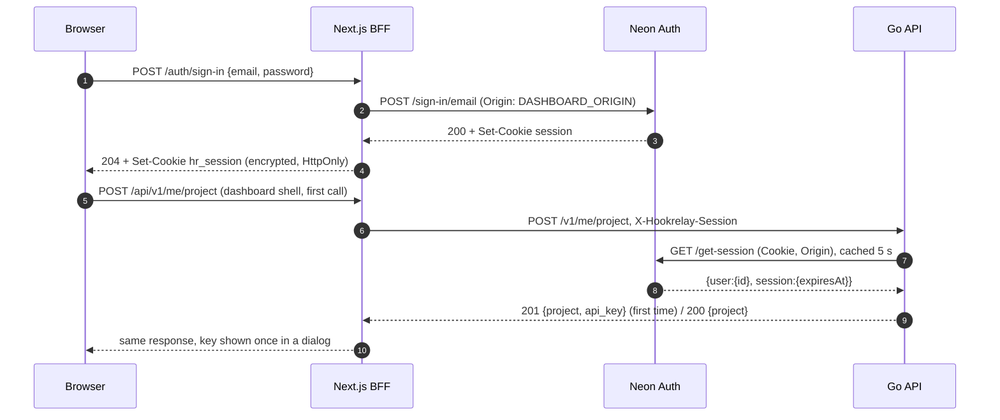

# US-025 implementation plan: Neon Auth accounts and session verification

**Owner:** Architect · **Date:** 2026-11-09 · **Decision:** [ADR 0011](../adr/0011-dashboard-auth-neon-auth-sessions.md)
· **Contract:** `api/openapi.yaml` (`session` scheme, `POST /v1/me/project`, `409 project_not_provisioned`,
`503 auth_unavailable`) · **Migration:** `backend/migrations/0002_projects_neon_user_id.{up,down}.sql` (written)

## 0. Check these before coding (about 5 min, one throwaway account on a dev branch)

Use curl against `NEON_AUTH_BASE_URL` to confirm the following, and write the results at the
end of this file:

1. The exact session cookie name in `Set-Cookie`. It becomes the default of
   `NEON_AUTH_SESSION_COOKIE`.
2. The `GET /get-session` body for a valid session (`{session:{expiresAt,userId}, user:{id,...}}`)
   and for no session (`null` / `401`).
3. Status and `code` for a duplicate sign-up and for a wrong password.
4. That `DASHBOARD_ORIGIN` (`http://localhost:3000`, plus the production origin) is on Neon's
   list of trusted origins.

## 1. Backend (paths relative to `backend/internal/`). Write tests first in each step.

### Step 1. Domain: `project/domain`
- `entity/session_token.go`: `SessionToken` value object.
  `ParseSessionToken(s) (SessionToken, error)` accepts 1-2048 RFC 6265 cookie-octet characters
  (`[\x21\x23-\x2B\x2D-\x3A\x3C-\x5B\x5D-\x7E]`) and returns `ErrUnauthorized` for anything else.
  `Value()` returns the raw string. `String`, `Format` and `LogValue` redact, the same way `RawKey` does.
- `entity/session_user.go`: `SessionUser{ID string; ExpiresAt time.Time}`.
- `entity/project.go`:
  - Add `OwnerID string`. `""` means an API-key-only project.
  - Add `NewOwnedProject(id, ownerID, name, now)`, which rejects an empty owner (`ErrInvalid`).
  - Add `const DefaultProjectName = "My project"`.
- `errors/sentinel.go`: add `ErrAuthUnavailable` and `ErrProjectNotProvisioned`.
- `repository/project_repository.go`:
  - Add `GetByOwner(ctx, ownerID string) (entity.Project, error)`.
  - `CreateWithKey` now also returns `ErrConflict` when the owner is already taken.
- `repository/session_verifier.go`: **port** `SessionVerifier{ Verify(ctx, entity.SessionToken) (entity.SessionUser, error) }`.
  It returns `ErrUnauthorized` for an unknown, expired or signed-out session and
  `ErrAuthUnavailable` when the provider can't answer.

### Step 2. Use cases: `project/domain/usecase`, one per file, table-driven, fakes in `fakes_test.go`
| Use case | Route | Guards / flow (each one is a test row) |
|---|---|---|
| `AuthenticateSession{verifier}` → `Execute(ctx, {Token}) (userID string, error)` | internal (`RequireSession`, `RequireProject`) | Malformed → `ErrUnauthorized`, and the **verifier is not called**. A verifier `ErrUnauthorized` or `ErrAuthUnavailable` passes through, wrapped with `%w`. Success → user ID. |
| `GetOwnedProject{projects}` → `Execute(ctx, {UserID}) (entity.Project, error)` | internal (`RequireProject`) | `ErrNotFound` → `ErrProjectNotProvisioned`. A repo error is wrapped. Success. |
| `EnsureUserProject{deps}` → `Execute(ctx, {UserID}) ({Project, APIKey, Created}, error)` | `POST /v1/me/project` | `GetByOwner` finds the project → `Created=false`, no key. Any error other than not-found → wrap. Otherwise generate a key, then `provision` with the owner. `ErrConflict` (lost the race) → `GetByOwner` → `Created=false`. Conflict but still not found → wrapped `ErrConflict`. Success → `Created=true` with the raw key. A random-source failure is wrapped. |

`deps.go`: change `provision` to take `provisionSpec{Name, OwnerID string; Key entity.RawKey}`
(max 4 params). `CreateProject` and `SeedDemoProject` pass `OwnerID: ""`, so their behaviour
does not change.

### Step 3. Data
- **Migration 0002** (written): nullable `neon_user_id uuid` plus `UNIQUE`, `lock_timeout 5s`.
  The down migration drops the column. The integration test already runs up → down → up over all files.
- `data/model/project.go`: add `NeonUserID *string`.
- `data/source/project_persistent.go`:
  - The insert CTE gets `neon_user_id` (`$7`, nullable).
  - Add `GetByNeonUserID(ctx, id)`.
  - Every SELECT returns `neon_user_id::text`.
  - A unique violation on `projects_neon_user_id_key` → `ErrUniqueViolation` (the existing generic check covers it).
- `data/repository/`: the mapper converts `OwnerID` to and from `NeonUserID` (`""` ↔ `nil`). Add
  `GetByOwner`, which maps `ErrNotFound` the same way the other methods do.
- **Integration tests** (Testcontainers):
  - Two unowned projects can coexist.
  - The seeded project still authenticates by key.
  - **10 goroutines call `EnsureUserProject` for one user → 1 row, exactly 1 `Created=true`.**
  - `GetByOwner` keeps users A and B isolated.
- **New outbound adapter `project/data/neonauth/`** (package `neonauth`, same kind as `dispatch/data/webhookhttp`):
  - `client.go`: `Client` (`NewClient(Options{HTTP *http.Client; BaseURL, CookieName, Origin string})`) implements the port.
    - It sends `GET {base}/get-session` with `Cookie: {name}={value}`, `Origin` and `Accept: application/json`.
    - It reads the body through `io.LimitReader` at 64 KB.
    - Response mapping:

      | Neon response | Result |
      |---|---|
      | `200` with `user.id` as a UUID | `SessionUser` |
      | `200 null`, `401` | `ErrUnauthorized` |
      | anything else (3xx, 403, 5xx, bad JSON, non-UUID id, timeout, network error) | `ErrAuthUnavailable` wrapping the status or cause, **never the token** |
  - `caching_verifier.go`: `CachingVerifier{next, clock, ttl, maxEntries}` implements the port.
    - It caches positive results only, keyed by `sha256(token)`.
    - An entry expires at `min(now+ttl, ExpiresAt)`.
    - Expired entries are deleted when they are read.
    - When the cache is full, expired entries are swept and, if it is still full, the new result is not cached.
    - Concurrent calls for the same token are merged with `singleflight`.
    - A mutex inside the type guards the map.
    - `ttl == 0` passes straight through.
  - `disabled.go`: `Disabled{}` always returns `ErrUnauthorized`. It is used when
    `NEON_AUTH_BASE_URL` is empty (development without Neon), so that case still fails closed.
- **Layer rules:**
  - Add a depguard and `scripts/check-layers.sh` rule for `internal/*/data/neonauth`. Allowed: the
    stdlib (incl. `net/http`), `golang.org/x/sync/singleflight`, and its own module's
    `domain/{entity,errors,repository}`. Denied: `pgx`, `usecase`, `delivery`, `platform`.
  - Make `golang.org/x/sync` a direct dependency.

### Step 4. Delivery
- `platform/auth`: add `WithUserID(ctx, id)` and `UserID(ctx)`.
- `platform/httpx`:
  - Add the constants `CodeAuthUnavailable` and `CodeProjectNotProvisioned`.
  - Add `Error.Cause error` (`json:"-"`).
  - `Responder` logs every response with status ≥ 500 once, with `request_id` and the cause. A
    Neon outage is therefore visible in the logs, and its details never reach the client.
- `project/delivery/presenter/http`:
  - `middleware.go`: `RequireProject(ProjectGuardDeps{Keys, Sessions, Owned}, resp)` replaces `RequireAPIKey`.
    - Guard order: both `Authorization` and `X-Hookrelay-Session` → 401. `Authorization` → the
      US-001 path, unchanged. Session header → `AuthenticateSession` → `GetOwnedProject` →
      `auth.WithProjectID`. Neither → 401 **without calling the verifier**.
    - Extract `projectFromKey` and `projectFromSession` to keep one level of nesting.
    - Add `RequireSession(sessions, resp)` → `auth.WithUserID`.
  - `errors.go`:
    - `ErrAuthUnavailable` → `503 auth_unavailable` "authentication service unavailable, try again".
    - `ErrProjectNotProvisioned` → `409 project_not_provisioned`.
    - Leave the `ErrUnauthorized` message as it is (one identical 401 body for every credential type).
  - `ensure_user_project_handler.go`: `Handler.EnsureMine` reads the user from the ctx and calls
    `Execute`. It always sets `Cache-Control: no-store`. It answers `201 ProjectCreatedResponse`
    when `Created`, otherwise `200 ProjectResponse`. The DTOs are reused.
  - `handler.go`: `NewHandler(HandlerDeps{...})`, because there are now more than 4 collaborators.
  - `routes.go`: `Routes(mux, h, Guards{Project, Session})`, plus `POST /v1/me/project` behind `Session`.
- **Handler tests** (`httptest`, fake use cases):
  - Route table: every protected route answers 401 with no credential, and the fake verifier's call count is 0.
  - Malformed, unknown, expired and signed-out sessions all give a body **byte-identical to the
    US-001 `unauthorizedBody` constant**.
  - Both headers → 401.
  - Unavailable → 503 in the error shape.
  - A session for user A → A's project ID reaches the handler.
  - `EnsureMine`: 201 with `api_key` and `no-store`. 200 has no `api_key` property at all.
  - The US-001 tests are untouched.

### Step 5. Config and wiring
- `platform/config`:

  | Variable | Default | Validation |
  |---|---|---|
  | `NEON_AUTH_BASE_URL` | — | required and `https` in production; empty in development → `Disabled` |
  | `NEON_AUTH_SESSION_COOKIE` | value confirmed in step 0 | |
  | `DASHBOARD_ORIGIN` | — | required when the base URL is set; scheme+host only |
  | `NEON_AUTH_TIMEOUT` | `3s` | < request timeout |
  | `SESSION_CACHE_TTL` | `5s` | 0-60 s |

  Update `.env.example` and compose (`api` and `web`).
- `cmd/server/api.go`:
  - `&http.Client{Timeout: cfg.NeonAuthTimeout, CheckRedirect: func(...) error { return http.ErrUseLastResponse }}`
    → `neonauth.NewClient` → `neonauth.NewCachingVerifier(client, clk, cfg.SessionCacheTTL, 10_000)`.
  - → `AuthenticateSession`, `GetOwnedProject`, `EnsureUserProject` → `RequireProject` and
    `RequireSession` → `projecthttp.Routes`.
  - The `RequireProject` middleware becomes the `authed` passed to every later module's routes.
    The outbound HTTP client is built here (no globals).
- Run the self-check from `.claude/references/backend-architecture.md` §4.

## 2. Frontend (`frontend/src`). Neon is called only from server code. Cookies stay httpOnly.

1. `npm run gen:api`. `lib/api/client.ts`: `openapi-fetch` with `baseUrl: "/api"`. A 401 from
   any call → `location.assign("/sign-in")`. A 409 `project_not_provisioned` → run ensure again.
2. `lib/server/env.ts` (`import "server-only"`): validates `NEON_AUTH_BASE_URL`,
   `NEON_AUTH_SESSION_COOKIE`, `DASHBOARD_ORIGIN`, `API_INTERNAL_URL` and `SESSION_SECRET`
   (≥ 32 bytes) once.
3. `lib/server/session.ts`:
   - `sealSession({value, expiresAt})`, `readSession()`, `clearSession()`, using `jose`
     `EncryptJWT` (`dir` / `A256GCM`, key = SHA-256 of `SESSION_SECRET`).
   - Cookie options: `hr_session`, `httpOnly`, `secure` in production, `sameSite: "lax"`,
     `path: "/"`, `expires` = Neon `expiresAt`.
4. `lib/server/neon-auth.ts`:
   - `signUp`, `signIn` and `signOut(value)` call `fetch` with `Origin: DASHBOARD_ORIGIN`,
     `cache: "no-store"` and `AbortSignal.timeout(5000)`. Each returns a union:
     `ok | invalid_credentials | email_taken | unavailable`.
   - `extractSessionCookie(res.headers.getSetCookie(), name)` returns the value and expiry.
5. `lib/server/origin.ts`: `assertSameOrigin(req)`. Every non-GET request is checked, and a mismatch → 403.
6. Route handlers. None of them logs a body or a cookie.
   - `app/auth/sign-up/route.ts`:
     - Syntactic checks: the name is trimmed and 1-100 characters, the email is valid, the password is ≥ 8 characters.
     - A failed check → `400` with `field`, and Neon is not called.
     - `email_taken` → `409` "An account with this email already exists".
     - `ok` → set `hr_session` → `204`.
   - `app/auth/sign-in/route.ts`: a wrong password and an unknown email both → `401` "Invalid email
     or password", with no `Set-Cookie`. Neon down → `503`.
   - `app/auth/sign-out/route.ts`: Neon `POST /sign-out` with the session cookie, then always
     delete `hr_session` → `204`.
7. `app/api/v1/[...path]/route.ts` (GET, POST, PATCH):
   - Checks: origin check. No session → `401` straight away (the same body as Go's). `/v1/projects` → `403`.
   - Forwarding: forwards to `${API_INTERNAL_URL}/v1/...` with `X-Hookrelay-Session`. Only
     `content-type`, `idempotency-key` and `x-request-id` are passed through. Browser
     `Authorization`, `Cookie` and `X-Hookrelay-Session` are dropped.
   - Response: status, body and `X-Request-Id` are returned as they are. A `401` from Go deletes the cookie.
8. `middleware.ts`:
   - Protected pages (everything except `/sign-in`, `/sign-up`, `/auth/*`, `/api/*` and static files)
     without `hr_session` → `/sign-in?next=...`.
   - Signed-in users who open `/sign-in` or `/sign-up` → `/endpoints`.
   - The middleware checks only that the cookie is there. Expired and signed-out sessions are
     caught by the 401 → redirect in step 1.
9. Pages:
   - `app/(auth)/sign-up/page.tsx`, `app/(auth)/sign-in/page.tsx`: client forms with per-field
     messages (`aria-describedby`).
   - `app/(app)/layout.tsx`:
     - The shell runs `useEnsureProject()` (`POST /api/v1/me/project`, once per mount) **before
       any other query** (`enabled: ensured`).
     - The header shows the project name and a "Sign out" button.
     - On `201` it shows `components/api-key-once-dialog.tsx`: the key, a copy button and "I've
       saved it". The key lives in React state only and is dropped when the dialog closes.

## 3. Test strategy

| Layer | What | How |
|---|---|---|
| Go entity / use case | Steps 1-2 table rows | fakes, fixed clock and IDs, `go test -race` |
| Go adapter | `neonauth.Client` status mapping, headers sent (`Cookie`, `Origin`), timeout, 64 KB cap, redirects not followed; `CachingVerifier` TTL and `expiresAt` cap with a fake clock, negative and error results not cached, 20 concurrent → 1 upstream call, full-cache behaviour | `httptest.Server` as a fake Neon |
| Go handler | route-table 401 without a verifier call, identical 401 bodies, 503, 409, A/B scoping, `EnsureMine` 200/201 | `httptest`, fake use cases |
| Go integration | migration 0002 up/down/up, concurrent ensure → 1 project, unowned projects unaffected | Testcontainers Postgres |
| Frontend unit | sign-in: wrong password and unknown email give the same body and no cookie; sign-up `email_taken` → 409; cookie flags; the proxy strips browser credentials, forwards the session, clears the cookie on 401 and rejects a foreign `Origin`; `extractSessionCookie` | vitest, mocked `fetch` |
| E2E (optional, tag `@neon`) | sign-up with `e2e+<runId>@example.com` → key dialog once (a reload shows no dialog) → header "My project" → `document.cookie` and storage hold no credential → sign-out → a protected page redirects → the same message for a wrong password and an unknown email → duplicate sign-up message | Playwright against the real Neon (creates real accounts; skipped when `NEON_AUTH_BASE_URL` is empty) |
| Log AC | QA greps the `api` and `web` logs after the E2E run for the password, the cookie value and the token | the E2E writes the values to a temp file for the grep |

Tests use `SESSION_CACHE_TTL=0`, or a fake clock, for the "signed out → 401" cases.

## 4. Risks
- **Neon per-IP rate limits:** every sign-in comes from the BFF's IP, and every `get-session`
  comes from Go's IP. The 5 s cache and `singleflight` cover Go. For the BFF, forward the
  client IP (`X-Forwarded-For` from `Fly-Client-IP`) if Neon honours it. Check this in step 0.
- **Lost API key:** there is no rotation until US-013. See the PM question in ADR 0011 / the hand-off.

## 5. Step 0 findings
Confirmed on 2026-11-09 against the real `NEON_AUTH_BASE_URL` with a throwaway account
(`test+<unix-ts>@example.com`, random password; no token, password or cookie value was printed).
Origin sent: `http://localhost:3000`.

| Check | Result |
|---|---|
| **Session cookie name** | **`__Secure-neon-auth.session_token`** (`HttpOnly; Secure; Path=/`, value about 83 chars). This is the default of `NEON_AUTH_SESSION_COOKIE`. The `__Secure-` prefix is part of the name. |
| Other cookies in `Set-Cookie` | `sign-out` clears `__Secure-neon-auth.session_token`, `__Secure-neon-auth.session_data` and `__Secure-neon-auth.dont_remember` (empty values). The BFF only needs `session_token`. |
| Cookie expiry | The `Set-Cookie` of `session_token` has **no `Expires`**; the real expiry is `session.expiresAt` from `GET /get-session` (or `Max-Age` if the BFF sees one). The BFF should take the expiry from `get-session`, or fall back to a fixed lifetime (for example 7 days, the server decides). |
| `POST /sign-up/email` ok | `200`, body `{token, user:{id,email,name,...}}`, `Set-Cookie` session_token. Needs `{email, password, name}`. |
| `POST /sign-in/email` ok | `200`, body `{redirect, token, user:{...}}`, `Set-Cookie` session_token. |
| Duplicate sign-up | **`422`**, `{message, code:"USER_ALREADY_EXISTS_USE_ANOTHER_EMAIL"}`, no cookie. Map to `email_taken`. |
| Wrong password | **`401`**, `{message, code:"INVALID_EMAIL_OR_PASSWORD"}`, no cookie. |
| Unknown email | **`401`**, the **same** `INVALID_EMAIL_OR_PASSWORD` body (no account enumeration from Neon). |
| `GET /get-session`, valid | `200`, `{session:{id,token,userId,expiresAt (ISO string),createdAt,updatedAt,ipAddress,userAgent,...}, user:{id (UUID, 36 chars),email,name,...}}`. |
| `GET /get-session`, no cookie / garbage cookie / after sign-out | **`200` with body `null`** (not 401). The Go adapter maps `200 null` and `401` to `ErrUnauthorized`. |
| `get-session` without `Origin` | Still `200` with a valid session. The adapter sends `Origin` anyway (ADR 0011). |
| `POST /sign-out` | `200 {success:true}`; the session is dead immediately (`get-session` then returns `null`). |
| Untrusted origin (`http://evil.example`) on sign-in | **`403`**, `{code:"INVALID_ORIGIN"}`. `http://localhost:3000` is accepted, so it is on the trusted list. The production `DASHBOARD_ORIGIN` still has to be added to Neon's trusted origins. |
| Forwarding the client IP | Not tested (all calls came from one IP). The rate-limit risk in section 4 is still open. |

Frontend notes:
- Neon error `code` values to map: `USER_ALREADY_EXISTS_USE_ANOTHER_EMAIL` (HTTP 422), `INVALID_EMAIL_OR_PASSWORD` (HTTP 401), `INVALID_ORIGIN` (HTTP 403, a misconfiguration, not a user error: return 503 and log it).
- The cookie *value* is what goes into `hr_session` (encrypted) and later into `X-Hookrelay-Session`. It can contain `%` (URL-encoded signature), which is valid cookie-octet syntax; do not decode it.

### Backend implementation notes (US-025)
- Go ports and adapters as planned. Deviations that keep the US-001 tests unchanged:
  `GetByOwner` is a separate port `OwnedProjectRepository` (and source interface `OwnedProjectPersistent`)
  instead of a method on `ProjectRepository`; `RequireAPIKey`, `Routes` and `NewHandler` keep their
  signatures, and the session pieces are new (`RequireProject`, `RequireSession`, `MeHandler`, `MeRoutes`).
- `SessionToken` redacts through `String`/`GoString`/`Format` only; it has no `LogValue` because
  `domain/entity` may not import `log/slog`.
- New config: `NEON_AUTH_BASE_URL`, `NEON_AUTH_SESSION_COOKIE`, `DASHBOARD_ORIGIN`, `NEON_AUTH_TIMEOUT`, `SESSION_CACHE_TTL`
  (`.env.example` and `docker-compose.yml` updated for `api` and `web`).
